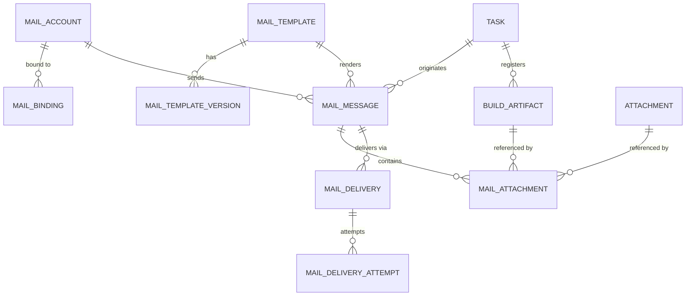
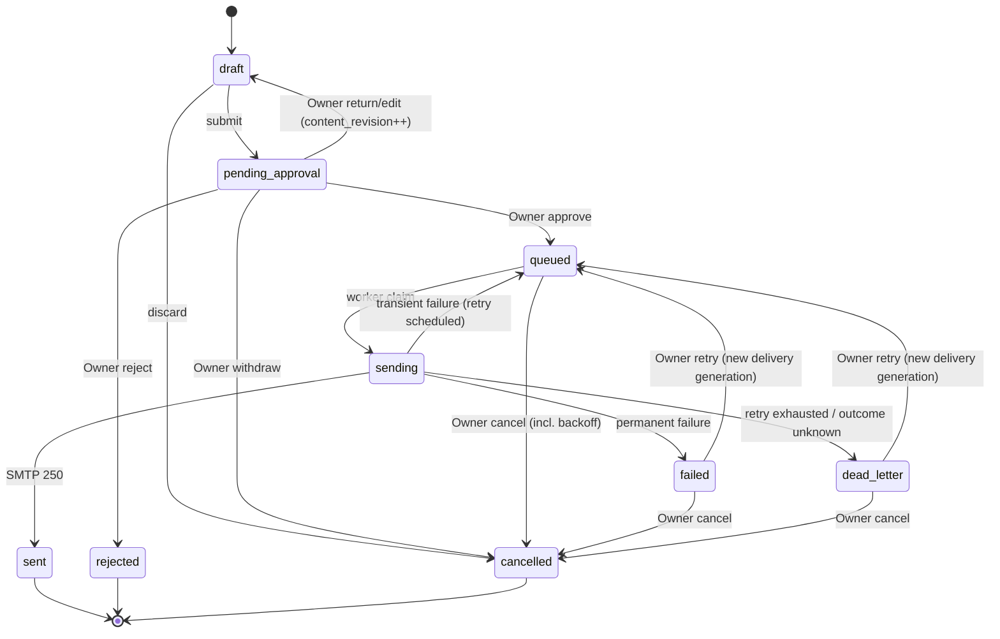
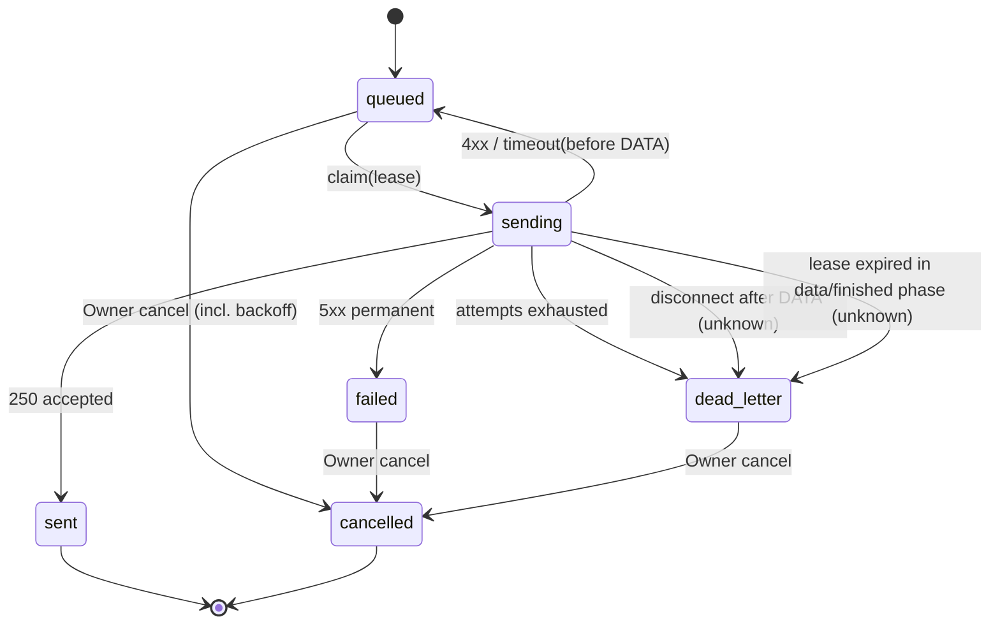

# AHA2 邮件资源一期设计：网易企业邮箱发信、模板与审批

- 状态：设计草案，待 Owner 评审
- 任务：task-119
- 日期：2026-11-05
- 范围：设计文档。不修改 Go/Web/部署脚本，不接入真实账号或授权码，不执行真实发信。
- 关联文档：[核心设计](core-design.md)、[Hardware 调试](hardware-debug.md)、[Agent API](agent-api.md)、[渠道插件一期设计](channel-plugin-v1-design.md)

## 0. 结论摘要

一期把邮件定义为 **Task 可绑定的外部能力**，而不是聊天渠道：

1. 邮件账号是系统级资源，像硬件资源一样由 Owner 维护；Project、Workspace、Task 通过绑定声明可用账号。
2. 一期只做 **出站发信**，使用网易企业邮箱 SMTP（SSL 465）。不接 IMAP、不接收邮件、不做邮件会话。
3. Agent 只能创建 **待审批邮件**；Owner 默认逐封审批。审批通过后由 durable outbox 投递，状态回到 Task 时间线。
4. 模板是带版本、带变量校验的渲染快照；审批和投递都以快照为准，模板后续修改不影响已提交邮件。
5. 凭据只进现有 Secret Store，数据库只保存 `credential_ref` 与 `credential_configured`；任何 API、日志、Prompt 都不返回授权码。
6. 不引入 `ChannelInstance`、`Conversation`、`IdentityLink`，不复用渠道会话/身份/收件箱/outbox 语义。

一期的成功标准：Owner 能在「资源 → 邮件」维护账号与模板；Agent 能在 Task 内预览并提交待审批邮件；Owner 在时间线批准后邮件可投递；失败可重试、可进死信、可审计；以上过程不泄露凭据。

## 1. 领域模型与边界

### 1.1 设计原则

- **外部能力，不是渠道**：邮件没有「会话」「成员」「在线状态」「回复路由」。一封邮件是一次带收件人的不可逆外发动作。
- **账号是系统资源，绑定是作用域声明**：账号与凭据只维护一份；Project/Workspace/Task 只声明「可以使用哪个账号」以及默认模板。
- **审批先于投递**：一期默认每封邮件都经过 Owner 审批；Agent 不能审批自己的邮件。
- **快照先于发送**：审批卡、投递 worker 和审计看到的是同一份不可变渲染快照。
- **凭据与内容分离**：凭据只在 SMTP worker 内短期解析；数据库、API、日志、Prompt、时间线都没有授权码。
- **复用现有基础设施，不复用渠道领域**：复用 Secret Store、Task 附件、Task 时间线投影、Event Hub、Audit、Agent capability；不创建渠道对象。

### 1.2 实体

#### Mail Account

Owner 维护的系统级发信账号。

| 字段 | 说明 |
| --- | --- |
| `id` | `mail_account_...`，稳定 ID |
| `name` | Owner 可读名称，例如「构建通知」 |
| `address` | 主发件地址，必须是企业邮箱已授权地址（设计中使用 `noreply@example.com` 占位） |
| `display_name` | 发件人显示名 |
| `provider` | 一期固定 `netease_qiye` |
| `smtp_host` / `smtp_port` / `smtp_security` | 默认 `smtp.qiye.163.com:465` / `ssl`；备用主机见第 3 节 |
| `smtp_username` | SMTP 登录名，通常等于完整邮箱地址 |
| `credential_ref` | Secret Store 引用，例如 `mail-account/<id>/smtp/credential` |
| `credential_configured` | 是否已保存授权码；只暴露布尔值 |
| `status` | `unverified` / `ok` / `error` / `disabled` |
| `last_test_at` / `last_test_error_code` | 最近一次连接测试结果 |
| `imap_*` | 二期字段，预留但一期不启用 |

说账号是「系统级」不意味着跨设备同步：一期账号只存在于当前 AHA 实例，Profile Sync 集成不在范围内（见 9.7）。

#### Mail Template

可复用的邮件模板，支持 `global` 与 `project` 两种作用域。

| 字段 | 说明 |
| --- | --- |
| `id` | `mail_template_...` |
| `scope` / `project_id` | `global` 时 `project_id=''`；`project` 时必须属于一个 Project |
| `name` / `description` | 模板名称与说明 |
| `subject_template` | 主题模板 |
| `body_text_template` | 纯文本正文模板 |
| `body_html_template` | 富文本正文模板（可为空） |
| `default_to_json` / `default_cc_json` | 默认收件人，仅用于预填，最终以消息快照为准 |
| `required_variables_json` | 必填变量集合 |
| `current_version` | 当前版本号 |
| `status` | `active` / `archived` |

模板的每个已发布版本是不可变的，见 `Mail Template Version`。删除使用归档，不做物理删除，避免历史消息失去引用。

#### Mail Template Version

保存模板历史版本，保证审计和「消息引用的版本仍然可读」。版本内容包括主题/纯文本/HTML/变量声明，创建后不可修改。

#### Mail Binding

把账号绑定到 Project、Workspace 或 Task。绑定不复制账号或凭据。

| 字段 | 说明 |
| --- | --- |
| `id` | `mail_binding_...` |
| `scope_type` | `project` / `workspace` / `task` |
| `scope_id` | 对应实体 ID；应用层校验存在性 |
| `account_id` | 被授权使用的账号 |
| `default_template_id` | 可选，默认模板 |
| `approval_mode` | 一期固定 `always`；`allowlist_auto` 预留，服务端拒绝启用 |
| `allowed_recipients_json` | 可选收件人白名单；空表示不启用白名单限制 |
| `auto_send_enabled` | 一期固定 `0`，二期开关 |
| `enabled` | 是否启用 |
| `created_by` | Owner 用户 ID |

生效规则：

1. Task 可用账号 = Task 绑定 ∪ 所属 Workspace 绑定 ∪ 所属 Project 绑定（仅 `enabled=1`）。
2. 同一账号在多个作用域出现时按 Task → Workspace → Project 合并；Task 绑定覆盖默认模板与策略字段。
3. 绑定只授予「以该账号发信」的能力，不授予账号管理、凭据读取、审批或收信能力。
4. 账号默认停用/归档而不是物理删除；只有从未产生消息且无绑定的账号才允许物理删除。停用前需处理待审批/投递中邮件。
5. 绑定作用域删除时由应用层级联清理；SQLite 无法用单一外键覆盖三种作用域，因此需要事务内校验与清理测试。

#### Mail Message

一次逻辑发信请求及审批快照。它是「邮件」的权威记录，不是聊天消息。

| 字段 | 说明 |
| --- | --- |
| `id` | `mail_message_...` |
| `task_id` | 必填；Owner 测试发信不创建 Mail Message，只写审计 |
| `project_id` / `workspace_id` | 冗余快照，便于列表过滤 |
| `turn_id` / `agent_id` | 由哪个 Agent Turn 提交；Owner 手动创建时为空或 Owner |
| `account_id` / `binding_id` | 使用哪个账号、命中哪个绑定 |
| `template_id` / `template_version` | 模板来源；无模板时为空 |
| `source` | `agent` / `owner` |
| `idempotency_key` | 幂等键；同一 Task 内唯一 |
| `from_address` / `from_name` | 快照中的发件人，必须属于账号或其别名 |
| `to_json` / `cc_json` / `bcc_json` | 规范化后的收件人数组 |
| `reply_to` | 一期默认为空；如需支持必须是账号允许的地址 |
| `subject` | 渲染后的主题快照 |
| `body_text` / `body_html` | 渲染后的正文快照 |
| `variables_json` | 渲染输入（不含凭据、环境变量、任意本地路径） |
| `content_revision` | 内容修订号；提交后修改会递增并重置审批 |
| `approval_digest` | 当前提交内容的规范化摘要 |
| `status` | 见 2.4 状态机 |
| `approved_by` / `approved_at` / `rejected_reason` | 审批结果 |
| `submitted_at` / `created_at` / `updated_at` | 时间 |

#### Mail Delivery

一次逻辑投递的 durable outbox 记录，承载租赁、重试、错误码与投递结果。

| 字段 | 说明 |
| --- | --- |
| `id` | `mail_delivery_...` |
| `message_id` | 所属 Mail Message |
| `generation` | 重放代数；首次为 0，Owner 重试时递增 |
| `replay_of_id` | 重放来源 delivery |
| `account_id` | 冗余账号 ID，便于按账号限速与统计 |
| `state` | `queued` / `sending` / `sent` / `failed` / `dead_letter` / `cancelled` |
| `attempts` | 已尝试次数 |
| `available_at` | 下次可领取时间 |
| `lease_id` / `lease_until` | 单 worker 租赁，防止并发发送 |
| `smtp_phase` | `connect` / `tls` / `auth` / `mail_from` / `rcpt_to` / `data` / `finished`，用于判断断线是否可安全重试 |
| `message_id_header` | 生成的 RFC 5322 Message-ID，便于后续退信关联（二期） |
| `smtp_response` | 服务端最终响应摘要，不含认证信息 |
| `last_error_code` | 稳定错误码 |
| `outcome_certainty` | `provider_accepted` / `permanent_failure` / `unknown` |
| `approved_digest` | 审批时摘要；发送前校验，防止内容被替换 |
| `sent_at` / `created_at` / `updated_at` | 时间 |

每次 SMTP 尝试另写 `Mail Delivery Attempt`（见 2.2），用于审计与错误定位。

#### Mail Attachment

邮件附件是「对已有受控文件的引用」，不是任意路径，也不把二进制塞进 JSON。

| 字段 | 说明 |
| --- | --- |
| `id` | `mail_attachment_...` |
| `message_id` / `position` | 所属消息与顺序 |
| `source_type` | `task_attachment` / `build_artifact` |
| `source_id` | 对应 `attachments.id` 或 `build_artifacts.id` |
| `file_name` / `media_type` | 快照文件名与 MIME |
| `size_bytes` / `sha256` | 创建消息时服务端计算的快照 |
| `delivery_mode` | `direct`（直接附件）/ `link`（受控下载链接） |
| `disposition` | `attachment` / `inline`；一期仅允许 `attachment` |
| `link_token_ref` | 链接令牌的 Secret Store 引用，仅 worker 可解析 |
| `link_token_hash` | 令牌摘要，用于下载端点校验 |
| `link_expires_at` / `link_max_downloads` / `link_download_count` | 链接策略与使用计数 |
| `link_revoked_at` | 撤销时间 |

正文中的链接只保存稳定占位符 `%%MAIL_LINK:<mail_attachment_id>%%`，发送时由 worker 替换为真实链接。这样审批摘要稳定、重试可复用同一链接，令牌本身只存在于 Secret Store。

#### Build Artifact（附件来源之一）

「登记的构建产物」是带校验元数据的受控引用。一期优先把构建产物作为 Task 附件登记；外部 URL 只作为预留能力，默认关闭。

| 字段 | 说明 |
| --- | --- |
| `id` | `build_artifact_...` |
| `task_id` | 所属 Task |
| `label` / `package_name` / `version` | 展示与变量来源 |
| `size_bytes` / `sha256` | 注册时校验 |
| `storage_type` | `aha_attachment` / `external_url`（一期仅启用前者） |
| `attachment_id` / `external_url` | 二选一 |
| `registered_by` / `created_at` | 审计 |

一期允许 Agent 引用当前 Task 的 `attachment_id`，或引用已登记的 `build_artifact_id`。Agent 不能提交本地文件路径、URL 或任意二进制。

### 1.3 关系图



`MAIL_BINDING` 的 `scope_id` 可指向 Project、Workspace 或 Task，因此不与单一表画外键。

### 1.4 明确不引入的领域对象

一期**不**创建、**不**复用以下对象：

- `ChannelInstance`：邮箱不是渠道实例；不为每个账号创建插件、runtime、capability 或健康检查。
- `ChannelConversation` / `Conversation`：邮件没有会话。Task 时间线是既有 `conversation_items` 的展示投影，不是渠道 Conversation。
- `ChannelIdentityLink`：一期只发不收，不把收件人、发件人或 Agent 映射成渠道身份。
- `ChannelTaskRoute` / `ChannelSubscription` / `ChannelInbox`：没有入站消息、没有路由、没有接管、没有「无需回复」判定。
- `ChannelDeliveryOutbox`：邮件投递使用独立的 `mail_deliveries`。渠道 outbox 的会话顺序、provider 幂等窗口、回复语义不适用于 SMTP。
- `ChannelSession` / `ChannelHandoff` / 渠道能力票据：邮件审批是 Owner 对内容的审批，不是渠道接管。

**二期收信**同样不自动变成渠道会话。若实现 IMAP/收信，必须单独立项，定义不可信内容边界、隔离存储、选中读取和 Owner 显式授权；不能把收到的邮件直接当作 Agent 指令，也不能把邮件地址自动映射成 `IdentityLink`。

### 1.5 与硬件资源的同构与差异

| 维度 | 硬件资源 | 邮件资源 |
| --- | --- | --- |
| 是否 Task 外部能力 | 是 | 是 |
| 资源维护位置 | 资源页 → 硬件 Tab | 资源页 → 邮件 Tab |
| 绑定作用域 | Task | Project / Workspace / Task |
| 凭据 | Secret Store + `password_configured` | Secret Store + `credential_configured` |
| 权限 | `read_only` / `read_write` | 一期只有 `send`，无读信 |
| 审批 | 连接/发送由 Task 权限控制 | 每封邮件默认 Owner 审批 |
| 典型副作用 | 串口/网络命令 | 不可逆外发邮件 |
| Prompt 暴露 | `hardware.md`（无密码） | `mail.md`（无凭据、不内联邮件正文，见 4.6） |

邮件比硬件多出「内容审批、模板、投递 outbox」；硬件比邮件多出「连接复用、终端 I/O」。两者共享的只是「系统资源 + 作用域绑定 + Secret 引用」这一层抽象。

## 2. 数据库设计

### 2.1 约定

- 当前仓库 schema 为 v119，本文按 **schema v120** 编写；实现时以当时最大版本 +1 为准，迁移必须从现网版本可重入执行。
- SQLite 显式迁移、无 ORM。ID 为 TEXT；时间统一 UTC RFC3339 定长字符串（固定 9 位小数，例如 `2026-11-05T15:04:05.123456789Z`）或整数 epoch 毫秒，二者必须全局选定一种。`lease_until` / `available_at` 等 SQL 时间比较必须使用同一种定长格式/单位，避免同秒字典序误差；布尔用 INTEGER 0/1，JSON 列用 Store helper 编解码。
- 新增表全部使用 `CREATE TABLE IF NOT EXISTS`；新增索引使用 `CREATE INDEX IF NOT EXISTS`；不修改或删除既有表。
- 所有列表查询必须有稳定排序与分页上限；邮件正文与收件人属于敏感业务数据，默认日志不打印。

### 2.2 表草案（schema v120）

> 以下为可执行草案。字段名与约束以实现时的 Store/迁移测试为准；不在本设计任务中执行。

```sql
-- 账号：凭据只在 Secret Store，数据库只有引用和布尔状态
CREATE TABLE IF NOT EXISTS mail_accounts (
    id TEXT PRIMARY KEY,
    name TEXT NOT NULL DEFAULT '',
    address TEXT NOT NULL,
    display_name TEXT NOT NULL DEFAULT '',
    provider TEXT NOT NULL DEFAULT 'netease_qiye'
        CHECK(provider IN ('netease_qiye')),
    smtp_host TEXT NOT NULL DEFAULT 'smtp.qiye.163.com',
    smtp_port INTEGER NOT NULL DEFAULT 465,
    smtp_security TEXT NOT NULL DEFAULT 'ssl'
        CHECK(smtp_security IN ('ssl')),
    smtp_username TEXT NOT NULL,
    credential_ref TEXT NOT NULL DEFAULT '',
    credential_configured INTEGER NOT NULL DEFAULT 0
        CHECK(credential_configured IN (0,1)),
    status TEXT NOT NULL DEFAULT 'unverified'
        CHECK(status IN ('unverified','ok','error','disabled')),
    last_test_at TEXT NOT NULL DEFAULT '',
    last_test_error_code TEXT NOT NULL DEFAULT '',
    -- 二期预留；一期 imap_enabled 必须为 0
    imap_host TEXT NOT NULL DEFAULT '',
    imap_port INTEGER NOT NULL DEFAULT 0,
    imap_enabled INTEGER NOT NULL DEFAULT 0, -- 一期由服务层强制为 0；二期迁移不再需要重建表
    created_at TEXT NOT NULL,
    updated_at TEXT NOT NULL
);
CREATE UNIQUE INDEX IF NOT EXISTS idx_mail_accounts_address
    ON mail_accounts(lower(address));
CREATE INDEX IF NOT EXISTS idx_mail_accounts_status
    ON mail_accounts(status, updated_at DESC);

-- 别名：From 只能是主地址或这里登记的别名
CREATE TABLE IF NOT EXISTS mail_account_aliases (
    account_id TEXT NOT NULL REFERENCES mail_accounts(id) ON DELETE CASCADE,
    address TEXT NOT NULL,
    display_name TEXT NOT NULL DEFAULT '',
    position INTEGER NOT NULL DEFAULT 0,
    PRIMARY KEY(account_id, address)
);
CREATE UNIQUE INDEX IF NOT EXISTS idx_mail_aliases_address
    ON mail_account_aliases(lower(address));

-- 模板与不可变版本
CREATE TABLE IF NOT EXISTS mail_templates (
    id TEXT PRIMARY KEY,
    scope TEXT NOT NULL CHECK(scope IN ('global','project')),
    project_id TEXT NOT NULL DEFAULT '',
    name TEXT NOT NULL,
    description TEXT NOT NULL DEFAULT '',
    subject_template TEXT NOT NULL,
    body_text_template TEXT NOT NULL DEFAULT '',
    body_html_template TEXT NOT NULL DEFAULT '',
    default_to_json TEXT NOT NULL DEFAULT '[]',
    default_cc_json TEXT NOT NULL DEFAULT '[]',
    required_variables_json TEXT NOT NULL DEFAULT '[]',
    current_version INTEGER NOT NULL DEFAULT 1 CHECK(current_version >= 1),
    status TEXT NOT NULL DEFAULT 'active'
        CHECK(status IN ('active','archived')),
    created_by TEXT NOT NULL DEFAULT '',
    created_at TEXT NOT NULL,
    updated_at TEXT NOT NULL,
    CHECK((scope = 'global' AND project_id = '')
       OR (scope = 'project' AND project_id <> ''))
);
CREATE UNIQUE INDEX IF NOT EXISTS idx_mail_templates_active_name
    ON mail_templates(scope, project_id, name) WHERE status = 'active';
CREATE INDEX IF NOT EXISTS idx_mail_templates_project
    ON mail_templates(project_id, status, updated_at DESC);

CREATE TABLE IF NOT EXISTS mail_template_versions (
    template_id TEXT NOT NULL REFERENCES mail_templates(id) ON DELETE CASCADE,
    version INTEGER NOT NULL CHECK(version >= 1),
    subject_template TEXT NOT NULL,
    body_text_template TEXT NOT NULL,
    body_html_template TEXT NOT NULL,
    required_variables_json TEXT NOT NULL DEFAULT '[]',
    created_by TEXT NOT NULL DEFAULT '',
    created_at TEXT NOT NULL,
    PRIMARY KEY(template_id, version)
);

-- 绑定：scope_id 由应用层校验，无法映射到单一外键
CREATE TABLE IF NOT EXISTS mail_bindings (
    id TEXT PRIMARY KEY,
    scope_type TEXT NOT NULL CHECK(scope_type IN ('project','workspace','task')),
    scope_id TEXT NOT NULL,
    account_id TEXT NOT NULL REFERENCES mail_accounts(id) ON DELETE RESTRICT,
    default_template_id TEXT REFERENCES mail_templates(id) ON DELETE SET NULL,
    approval_mode TEXT NOT NULL DEFAULT 'always'
        CHECK(approval_mode IN ('always','allowlist_auto')),
    allowed_recipients_json TEXT NOT NULL DEFAULT '[]',
    auto_send_enabled INTEGER NOT NULL DEFAULT 0 CHECK(auto_send_enabled IN (0,1)),
    enabled INTEGER NOT NULL DEFAULT 1 CHECK(enabled IN (0,1)),
    created_by TEXT NOT NULL DEFAULT '',
    created_at TEXT NOT NULL,
    updated_at TEXT NOT NULL,
    UNIQUE(scope_type, scope_id, account_id)
);
CREATE INDEX IF NOT EXISTS idx_mail_bindings_scope
    ON mail_bindings(scope_type, scope_id, enabled);
CREATE INDEX IF NOT EXISTS idx_mail_bindings_account
    ON mail_bindings(account_id, enabled);

-- 构建产物登记：一期只允许 aha_attachment；external_url 预留且默认拒绝
CREATE TABLE IF NOT EXISTS build_artifacts (
    id TEXT PRIMARY KEY,
    task_id TEXT NOT NULL REFERENCES tasks(id) ON DELETE CASCADE,
    label TEXT NOT NULL,
    package_name TEXT NOT NULL DEFAULT '',
    version TEXT NOT NULL DEFAULT '',
    size_bytes INTEGER NOT NULL CHECK(size_bytes >= 0),
    sha256 TEXT NOT NULL,
    storage_type TEXT NOT NULL DEFAULT 'aha_attachment'
        CHECK(storage_type IN ('aha_attachment','external_url')),
    attachment_id TEXT REFERENCES attachments(id) ON DELETE RESTRICT,
    external_url TEXT NOT NULL DEFAULT '',
    registered_by TEXT NOT NULL DEFAULT '',
    created_at TEXT NOT NULL,
    CHECK((storage_type = 'aha_attachment' AND attachment_id IS NOT NULL AND external_url = '')
       OR (storage_type = 'external_url' AND attachment_id IS NULL AND external_url <> ''))
);
CREATE INDEX IF NOT EXISTS idx_build_artifacts_task
    ON build_artifacts(task_id, created_at DESC);

-- 逻辑邮件与审批快照
CREATE TABLE IF NOT EXISTS mail_messages (
    id TEXT PRIMARY KEY,
    task_id TEXT NOT NULL REFERENCES tasks(id) ON DELETE CASCADE,
    project_id TEXT NOT NULL DEFAULT '',
    workspace_id TEXT NOT NULL DEFAULT '',
    turn_id TEXT NOT NULL DEFAULT '',
    agent_id TEXT NOT NULL DEFAULT '',
    account_id TEXT NOT NULL REFERENCES mail_accounts(id) ON DELETE RESTRICT,
    binding_id TEXT REFERENCES mail_bindings(id) ON DELETE SET NULL,
    template_id TEXT REFERENCES mail_templates(id) ON DELETE SET NULL,
    template_version INTEGER NOT NULL DEFAULT 0,
    source TEXT NOT NULL CHECK(source IN ('agent','owner')),
    idempotency_key TEXT NOT NULL,
    from_address TEXT NOT NULL,
    from_name TEXT NOT NULL DEFAULT '',
    to_json TEXT NOT NULL DEFAULT '[]',
    cc_json TEXT NOT NULL DEFAULT '[]',
    bcc_json TEXT NOT NULL DEFAULT '[]',
    reply_to TEXT NOT NULL DEFAULT '',
    subject TEXT NOT NULL,
    body_text TEXT NOT NULL DEFAULT '',
    body_html TEXT NOT NULL DEFAULT '',
    variables_json TEXT NOT NULL DEFAULT '{}',
    content_fingerprint TEXT NOT NULL DEFAULT '',
    content_revision INTEGER NOT NULL DEFAULT 1 CHECK(content_revision >= 1),
    approval_digest TEXT NOT NULL DEFAULT '',
    status TEXT NOT NULL DEFAULT 'draft'
        CHECK(status IN ('draft','pending_approval','queued','sending','sent',
                         'failed','dead_letter','rejected','cancelled')),
    approved_by TEXT NOT NULL DEFAULT '',
    approved_at TEXT NOT NULL DEFAULT '',
    rejected_reason TEXT NOT NULL DEFAULT '',
    submitted_at TEXT NOT NULL DEFAULT '',
    created_at TEXT NOT NULL,
    updated_at TEXT NOT NULL,
    UNIQUE(task_id, idempotency_key)
);
CREATE INDEX IF NOT EXISTS idx_mail_messages_task
    ON mail_messages(task_id, status, created_at DESC);
CREATE INDEX IF NOT EXISTS idx_mail_messages_pending
    ON mail_messages(status, created_at) WHERE status = 'pending_approval';
CREATE INDEX IF NOT EXISTS idx_mail_messages_account
    ON mail_messages(account_id, created_at DESC);
CREATE INDEX IF NOT EXISTS idx_mail_messages_dedup
    ON mail_messages(task_id, account_id, created_at DESC);
CREATE INDEX IF NOT EXISTS idx_mail_messages_fingerprint
    ON mail_messages(task_id, content_fingerprint, created_at DESC);

-- 附件快照；direct 与 link 二选一
CREATE TABLE IF NOT EXISTS mail_attachments (
    id TEXT PRIMARY KEY,
    message_id TEXT NOT NULL REFERENCES mail_messages(id) ON DELETE CASCADE,
    position INTEGER NOT NULL DEFAULT 0,
    source_type TEXT NOT NULL CHECK(source_type IN ('task_attachment','build_artifact')),
    source_id TEXT NOT NULL,
    file_name TEXT NOT NULL,
    media_type TEXT NOT NULL DEFAULT 'application/octet-stream',
    size_bytes INTEGER NOT NULL CHECK(size_bytes >= 0),
    sha256 TEXT NOT NULL,
    delivery_mode TEXT NOT NULL CHECK(delivery_mode IN ('direct','link')),
    disposition TEXT NOT NULL DEFAULT 'attachment'
        CHECK(disposition IN ('attachment','inline')),
    link_token_ref TEXT NOT NULL DEFAULT '',
    link_token_hash TEXT NOT NULL DEFAULT '',
    link_expires_at TEXT NOT NULL DEFAULT '',
    link_max_downloads INTEGER NOT NULL DEFAULT 0,
    link_download_count INTEGER NOT NULL DEFAULT 0,
    link_revoked_at TEXT NOT NULL DEFAULT '',
    created_at TEXT NOT NULL,
    UNIQUE(message_id, position)
);
CREATE INDEX IF NOT EXISTS idx_mail_attachments_message
    ON mail_attachments(message_id, position);
CREATE INDEX IF NOT EXISTS idx_mail_attachments_source
    ON mail_attachments(source_type, source_id);
CREATE UNIQUE INDEX IF NOT EXISTS idx_mail_attachments_link_hash
    ON mail_attachments(link_token_hash) WHERE link_token_hash <> '';

-- 投递 outbox
CREATE TABLE IF NOT EXISTS mail_deliveries (
    id TEXT PRIMARY KEY,
    message_id TEXT NOT NULL REFERENCES mail_messages(id) ON DELETE CASCADE,
    generation INTEGER NOT NULL DEFAULT 0 CHECK(generation >= 0),
    replay_of_id TEXT REFERENCES mail_deliveries(id) ON DELETE SET NULL,
    account_id TEXT NOT NULL REFERENCES mail_accounts(id) ON DELETE RESTRICT,
    state TEXT NOT NULL DEFAULT 'queued'
        CHECK(state IN ('queued','sending','sent','failed','dead_letter','cancelled')),
    attempts INTEGER NOT NULL DEFAULT 0 CHECK(attempts >= 0),
    available_at TEXT NOT NULL,
    lease_id TEXT NOT NULL DEFAULT '',
    lease_until TEXT NOT NULL DEFAULT '',
    smtp_phase TEXT NOT NULL DEFAULT ''
        CHECK(smtp_phase IN ('','connect','tls','auth','mail_from','rcpt_to','data','finished')),
    message_id_header TEXT NOT NULL DEFAULT '',
    smtp_response TEXT NOT NULL DEFAULT '',
    last_error_code TEXT NOT NULL DEFAULT '',
    last_error_detail TEXT NOT NULL DEFAULT '',
    outcome_certainty TEXT NOT NULL DEFAULT ''
        CHECK(outcome_certainty IN ('','provider_accepted','permanent_failure','unknown')),
    approved_digest TEXT NOT NULL DEFAULT '',
    sent_at TEXT NOT NULL DEFAULT '',
    created_at TEXT NOT NULL,
    updated_at TEXT NOT NULL,
    UNIQUE(message_id, generation)
);
-- 领取 queued；回收过期 sending 需要单独索引
CREATE INDEX IF NOT EXISTS idx_mail_deliveries_claim
    ON mail_deliveries(state, available_at) WHERE state = 'queued';
CREATE INDEX IF NOT EXISTS idx_mail_deliveries_reclaim
    ON mail_deliveries(state, lease_until) WHERE state = 'sending';
CREATE INDEX IF NOT EXISTS idx_mail_deliveries_account
    ON mail_deliveries(account_id, state, updated_at DESC);
CREATE INDEX IF NOT EXISTS idx_mail_deliveries_claim_account
    ON mail_deliveries(account_id, state, available_at) WHERE state = 'queued';
-- 同一消息同一时刻最多一个 active delivery；重试只在旧 generation 结束后创建
CREATE UNIQUE INDEX IF NOT EXISTS idx_mail_deliveries_active_message
    ON mail_deliveries(message_id) WHERE state IN ('queued','sending');

CREATE TABLE IF NOT EXISTS mail_delivery_attempts (
    id TEXT PRIMARY KEY,
    delivery_id TEXT NOT NULL REFERENCES mail_deliveries(id) ON DELETE CASCADE,
    attempt_no INTEGER NOT NULL CHECK(attempt_no >= 1),
    lease_id TEXT NOT NULL,
    outcome TEXT NOT NULL
        CHECK(outcome IN ('sent','transient_failure','permanent_failure','unknown','cancelled')),
    error_code TEXT NOT NULL DEFAULT '',
    smtp_code INTEGER NOT NULL DEFAULT 0,
    backoff_ms INTEGER NOT NULL DEFAULT 0,
    started_at TEXT NOT NULL,
    finished_at TEXT NOT NULL DEFAULT '',
    UNIQUE(delivery_id, attempt_no)
);
CREATE INDEX IF NOT EXISTS idx_mail_delivery_attempts_delivery
    ON mail_delivery_attempts(delivery_id, attempt_no);
```

### 2.3 关键索引理由

| 索引 | 用途 |
| --- | --- |
| `idx_mail_accounts_address` | 防止同一发件地址重复配置 |
| `idx_mail_templates_active_name` | 同作用域同名的 active 模板唯一 |
| `idx_mail_bindings_scope` | Task/Workspace/Project 详情页读取有效绑定 |
| `idx_mail_messages_task` | Task 时间线/发送记录按状态与时间分页 |
| `idx_mail_messages_pending` | Owner 待审批列表只扫 pending 行 |
| `idx_mail_messages_fingerprint` | 10 分钟重复内容检测走索引，不扫全表 |
| `idx_mail_deliveries_claim` | worker 以 `(state, available_at)` 领取 queued，避免全表扫描 |
| `idx_mail_deliveries_reclaim` | 回收 `state='sending' AND lease_until<now` 的失联租约 |
| `idx_mail_deliveries_claim_account` | 按账号并发/限速时领取各自 queued 队列 |
| `idx_mail_deliveries_active_message` | 唯一约束保证同一消息最多一个 queued/sending generation |
| `idx_mail_attachments_source` | 校验引用来源、清理时按来源反查 |
| `idx_mail_attachments_link_hash` | 受控下载端点按令牌摘要唯一定位附件 |

### 2.4 状态机

#### Mail Message



规则：

- `sent` 只表示 **服务商 SMTP 接受（250）**，不等同于收件人已读或已进入收件箱。列表与 API 必须展示 `outcome_certainty=provider_accepted`。
- `pending_approval` 的内容快照不可被 Agent 修改；Owner 修改必须递增 `content_revision`，清空旧审批并重新提交审批。
- `failed` 是**不会自动重试**的终态（永久性 SMTP 错误、认证失败、附件校验失败等）；`dead_letter` 是重试耗尽或结果不确定、需要 Owner 决定的终态。
- Owner 从 `failed` / `dead_letter` 重试时创建新 `generation` 的 Delivery，原记录与其 Attempts 保留审计；不覆盖旧状态。
- `draft` 只由 Owner Web 创建/保存；Agent 提交直接进入 `pending_approval`，不能绕过审批。
- 取消：`draft`、`pending_approval`、`queued`（含退避等待）、`failed`、`dead_letter` 可由 Owner 取消；`sending` 一律不允许取消（包括 DATA 前），UI 显示「发送中，不可取消」。取消 `queued` 必须同时把对应 Delivery 置为 `cancelled` 并写审计。
- Task 进入 `completed/failed/cancelled` 后，已存在的 `pending_approval` 仍可审批/拒绝，`queued`/退避中的邮件继续投递；不能再创建新邮件或修改内容（见 6.1）。

#### Mail Delivery



- `smtp_phase` 是判断「可安全重试」的关键：连接、TLS、AUTH、MAIL FROM、RCPT TO 阶段断线可重试；`DATA` 之后断线属于结果不确定，禁止盲目重发，进入 `dead_letter` 并标记 `outcome_certainty=unknown`。
- 租赁过期（worker 崩溃）时，如果 `smtp_phase` 在 `data` 之前，Delivery 回收为 `queued` 并在同一事务把 Message 条件更新回 `queued`；否则进入 `dead_letter`，由 Owner 决定是否重试。
- 同一封邮件同一时刻最多一个 active delivery；重放生成新 `generation`，但不并发。
- 租约、进入 DATA 前的 `smtp_phase` 条件落盘、最终结果的 lease 校验、以及过期 `sending` 的回收 SQL 见 6.3；这些规则是本设计避免重复发送的强制约束，不能只由 worker 内存状态保证。

#### 审批

- 只有 Owner 会话/CSRF 校验的接口能 `approve` / `reject` / `retry` / `cancel`。
- Agent capability 不能调用审批接口；即使 Agent 知道 `message_id`，服务端也必须按路由和身份拒绝。
- 审批前服务端重新计算 `approval_digest` 并与提交时保存的值比较；不一致则拒绝批准（防止审批后被修改）。
- `approval_digest` 的计算范围固定为：`content_revision`、账号 ID、From 地址/显示名、To/CC/BCC、`reply_to`、主题、纯文本、HTML、每个附件的 `source_type/source_id/file_name/size_bytes/sha256/delivery_mode` 以及链接策略（有效期/下载上限）。不包含创建时间、审批人、尝试次数等易变字段；对规范化 JSON 计算 SHA-256。这样正常重试与状态变化不会改变审批对象。账号/From、收件人、附件或链接策略的任何变化都会改变摘要，必须复制为新草稿并重新审批；已提交消息不能回到 `pending_approval`，`retry` 不接受改绑字段。
- 批准时把 `approved_digest` 写入 Delivery；worker 发送前再次校验，任何不一致进入 `failed`，错误码 `mail_approval_digest_mismatch`。

### 2.5 Secret 引用与凭据

- 授权码只写入现有 `internal/secrets.FileStore`，键为 `mail-account/<account-id>/smtp/credential`。该文件权限为 0600（沿用现有 Secret Store 行为）。
- `mail_accounts.credential_ref` 保存引用，`credential_configured` 只暴露布尔值。
- 账号 API 的创建/更新请求接受一次性的 `authorization_code` 字段；响应永远不回显，日志、审计、Event、Prompt 不记录。
- 轮换：新授权码覆盖同一引用；成功后 `credential_configured=1`、`status='unverified'`，清空上次测试结果，要求重新测试。
- 删除：一期账号默认「停用/归档」而不是物理删除，以保留历史邮件、投递与审计；物理删除只允许从未产生任何 Mail Message/Delivery 且没有绑定的账号。停用后不能用于新发送，但仍出现在历史筛选中。物理删除账号行后再删除 Secret；Secret 删除失败只产生孤儿键，不能反向让账号继续可用。
- 连接测试和发送 worker 是唯一解析该引用的地方；解析后的字符串只在单次请求/单次发送的局部变量中存在，不写入任何持久化结构。
- 邮箱地址本身不是密码，但仍是业务敏感信息：默认列表展示完整发件地址给 Owner；Agent 只返回 `account_id`、发件地址、别名与显示名，不返回 `credential_ref`。
- 一期不做 Profile Sync 传输；如果后续需要同步账号，必须使用既有加密 infrastructure secret bundle 的显式 allowlist，不能把本实例 Secret 引用原样写进同步对象。

### 2.6 迁移与保留

- v120 迁移只新增表/索引，不改既有业务表，因此可在现网 v119 上幂等执行。
- 迁移测试至少覆盖：从 v119 空库升级、重复执行、外键/唯一约束、partial index 存在性。
- 建议保留策略（可配置）：Mail Message/Delivery/Attempts 90 天；模板版本长期保留；审计事件 1 年；受控下载链接默认 7 天。删除正文不等于删除审计元数据，清理任务必须单独设计，不能在本期静默执行。
- 草案中 Mail Message 对 Task 使用 `ON DELETE CASCADE`，与现有附件一致；如果 Owner 要求邮件审计独立于 Task 删除保留，实现时应改为软删除/归档表或 `ON DELETE RESTRICT`，并在迁移中明确选择。不能在不告知的情况下丢失已发送审计。

## 3. 网易企业邮箱接入

### 3.1 SMTP 参数

| 项 | 值 |
| --- | --- |
| 主 SMTP | `smtp.qiye.163.com:465` |
| 备用 SMTP | `smtphz.qiye.163.com:465` |
| 加密 | 隐式 TLS（SMTPS），端口 465 |
| 认证 | 客户端授权码（不是登录密码） |
| SMTP 用户名 | 完整企业邮箱地址，默认等于 `address` |
| From | 必须是主地址或其已登记别名 |
| 协议 | SMTP，RFC 5321/5322；MIME 编码 |

约束：

- 只允许隐式 TLS 465；禁止明文 25、禁止无证书校验、禁止 `InsecureSkipVerify`。最低 TLS 1.2。
- 主用主机连接失败（DNS/连接/TLS）时，按配置重试一次备用主机；认证失败不切换主机，避免把授权码发送到非预期端点。
- 备用主机也必须做证书链与主机名校验；TLS `ServerName` 使用实际连接的主机名。
- 认证优先 AUTH PLAIN，失败时允许 AUTH LOGIN；两者都失败映射为 `smtp_auth_failed`，不重试。授权码不进入日志。
- 发件人显示名使用 RFC 2047 编码；主题、地址、显示名、Message-ID 都必须拒绝 CR/LF 注入。
- 一期不支持自定义 `Reply-To`、`Sender`、`Return-Path`、批量个性化、群发列表；收件人总上限默认 50（To+CC+BCC）。
- 邮件正文采用 multipart/alternative（text + html）与 multipart/mixed（附件）；附件文件名做 RFC 2231 编码。
- 总超时：连接 10s、TLS 10s、AUTH 15s、DATA 60s、整封 180s；可配置但不能无限。

### 3.2 From 账号与别名限制

- 允许的 From 集合 = `mail_accounts.address` ∪ `mail_account_aliases.address`。
- 创建/编辑账号时校验格式与域名；同一地址不能出现在两个账号（包括别名）。
- Agent 只能选择账号，不能临时指定任意 From；Owner 也只能在允许集合内选择。
- 若网易企业邮箱管理后台未把别名配置为可发信，SMTP 可能返回 553/550；AHA 将其映射为 `smtp_sender_rejected` 并在账号测试中提示检查企业邮箱别名设置。
- 一期不允许「任意地址冒充」；不提供 `From` 自由输入框。

### 3.3 连接测试

`POST /api/v1/mail-accounts/{id}/test`：

1. DNS 解析主/备主机。
2. TCP + TLS 握手，记录协议版本与证书主题（不记录敏感信息）。
3. EHLO，记录服务端能力（是否 AUTH、SIZE）。
4. AUTH 使用 Secret Store 中的授权码。
5. QUIT，返回耗时与结果。

测试**不发送邮件**。另提供 `POST /api/v1/mail-accounts/{id}/test-send`：Owner 显式确认后，向指定地址发送一封固定内容的测试邮件；限制 1 个收件人、每账号每小时 3 次、写审计。测试发信不是 Mail Message，不进入审批流。

返回示例（成功）：

```json
{
  "ok": true,
  "level": "connect",
  "host": "smtp.qiye.163.com",
  "port": 465,
  "tls_version": "TLS1.3",
  "auth": "ok",
  "capabilities": ["AUTH", "SIZE"],
  "duration_ms": 412
}
```

返回示例（失败）：

```json
{
  "ok": false,
  "level": "auth",
  "error_code": "smtp_auth_failed",
  "retryable": false,
  "message": "SMTP 认证失败，请检查客户端授权码是否有效"
}
```

测试完成后更新 `last_test_at`、`last_test_error_code`、`status`。认证失败将账号置为 `error` 并阻止后续发送，直到重新测试成功或 Owner 显式启用。

### 3.4 SMTP 阶段、状态码与多收件人规则

SMTP 错误不能只按三位码判断：同一个 550 在 MAIL FROM、RCPT TO、DATA 阶段含义不同。服务端必须结合 `smtp_phase` 与响应码映射为稳定错误码。

| 阶段 | 响应/事件 | 稳定错误码 | 自动重试 | 处理 |
| --- | --- | --- | --- | --- |
| DNS/connect | 解析失败 | `smtp_dns_failed` | 有限 | 账号 `error`，提示检查网络/DNS |
| connect | TCP 超时/拒绝 | `smtp_connect_timeout` | 是 | 指数退避，尝试备用主机 |
| tls | 证书/握手失败 | `smtp_tls_failed` | 否/有限 | 不降级明文；账号 `error` |
| auth | 530/534/535/538 | `smtp_auth_failed` | 否 | 账号 `error`，消息 `failed`，轮换授权码 |
| auth | 421 | `smtp_service_unavailable` | 是 | 退避后重连，可切备用主机 |
| mail_from | 550/551/553/554 | `smtp_sender_rejected` | 否 | 检查 From/别名/企业邮箱授权 |
| mail_from | 4xx（421 除外） | `smtp_temporary_failure` | 是 | 整封退避 |
| rcpt_to | 任一 5xx | `smtp_recipient_rejected` | 否 | RSET，整封 `failed`，不向部分收件人发送 |
| rcpt_to | 任一 4xx 且无 5xx | `smtp_recipient_temporarily_unavailable` | 是 | RSET，整封重试，不向部分收件人发送 |
| data | 552 | `smtp_message_too_large` | 否 | 提示改用受控链接 |
| data | 554 | `smtp_content_rejected` | 否 | 内容/策略拒绝，整封 `failed` |
| data | 其他 5xx | `smtp_permanent_failure` | 否 | 整封 `failed` |
| data | 4xx | `smtp_temporary_failure` | 是 | 服务端明确拒收，整封重试安全 |
| 任意 | 421 | `smtp_service_unavailable` | 是 | 服务不可用/连接关闭，按本地退避重连 |
| 任意 | 450/451/452 | `smtp_temporary_failure` | 是 | 临时失败（信箱忙/本地错误/空间不足），不等同限速 |
| 任意 | 500/501/502/504 | `smtp_protocol_error` | 否 | 命令/协议错误，记录响应码，不自动重试 |
| DATA 前 | EOF/超时/连接重置 | `smtp_connection_lost` | 是 | 按 `smtp_phase` 判断，安全重试 |
| DATA 后 | 未收到最终响应即断线 | `smtp_ambiguous_after_data` | 否 | `dead_letter`，`outcome_certainty=unknown` |
| 本地预检 | 摘要/附件/账号问题 | `mail_*` | 否 | 修复后重新审批或重试 |

**多收件人规则**：

1. 连接前校验全部 To/CC/BCC；超过上限、格式错误或重复地址直接拒绝，不进入 SMTP。
2. `MAIL FROM` 接受后，对每个收件人发送 `RCPT TO` 并收集逐个响应；BCC 同样进入 RCPT，但不写入头字段。
3. 只要任一 RCPT 返回 5xx：发送 `RSET`，不发送 `DATA`，整封标记 `failed`（`smtp_recipient_rejected`）。禁止只向被接受的子集发送，避免部分投递、重复补发和收件人信息不一致。
4. 只要任一 RCPT 返回 4xx（且没有 5xx）：发送 `RSET`，不发送 `DATA`，整封按临时失败退避重试。禁止「先发给成功的那部分」。
5. 只有全部 RCPT 返回 2xx 才发送一次 `DATA`。`DATA` 后收到 250 表示全部已接受收件人被服务端接受；SMTP 不提供逐收件人的最终投递证明。
6. RCPT 响应无法解析或连接中断按临时失败处理：先 `RSET`，不得进入 `DATA`。

**重试策略**：最多 8 次 SMTP 尝试（1 次首发 + 7 次重试）。首发立即；第 1–6 次失败后的等待依次为 1s、5s、30s、2m、10m、1h；第 7 次失败后再等 1h 进行第 8 次尝试；第 8 次失败后进入 `dead_letter`。SMTP 没有 HTTP 风格的 `Retry-After` 响应头，禁止解析该头；若 421/4xx 响应文本包含建议等待时间，只记录为诊断，不改变本地退避。认证失败、永久 5xx、发件人/收件人/内容拒绝、本地校验失败不自动重试。

### 3.5 网易企邮限制的实测项

以下数值必须以企业邮箱套餐与管理后台为准，实现前用测试账号验证，不写死：

- 单封邮件最大大小（含 MIME 编码膨胀）。
- 每账号每小时/每天发信配额。
- 单封收件人上限。
- 别名发信的额外授权要求。
- 是否允许自定义 `Message-ID`、是否提供退信/回执。
- 465 端口备用主机是否与主主机使用同一证书与认证策略。

### 3.6 二期 IMAP 预留

- 数据库保留 `imap_host` / `imap_port` / `imap_enabled`，一期 `imap_enabled` 强制 0，UI 不展示收信开关。
- 一期不建立 IMAP 连接、不保存收件箱、不解析入站邮件、不提供收信 Agent 工具。
- 二期若实现收信，必须是独立设计：不可信内容隔离、按邮件/附件显式读取、附件扫描、Prompt 注入防护、身份不自动映射、审计与保留策略。
- 二期收信不得复用 `mail_messages` 的出站语义；建议独立的 `mail_inbound_*` 表与读取授权模型。

## 4. API 与 Agent 工具契约

### 4.1 认证与边界

- Owner API：沿用 Web Session + CSRF + 同源校验；只有 Owner 能管理账号、模板、绑定，以及审批/拒绝/重试/取消。
- Agent API：沿用 `/api/v1/agent` 的短期 Bearer capability，绑定 Task/Agent/Turn；服务端从 capability 取 Task，不接受客户端指定其他 Task。
- MCP 工具与 Agent HTTP API 共用同一服务层与校验；MCP 不提供额外权限。
- Agent 不能调用 Owner 路由；审批、账号 CRUD、测试发信只存在于 Owner 路由。
- 所有响应统一不包含 `credential_ref`、授权码、Secret 值、SMTP AUTH 行、完整 SMTP 原始会话。
- 错误统一为 `{"ok":false,"error":{"code":"...","message":"...","details":{}}}`；限流返回 429 + `retry_after_ms`。

### 4.2 Owner API

```text
GET    /api/v1/mail-accounts
POST   /api/v1/mail-accounts
GET    /api/v1/mail-accounts/{id}
PUT    /api/v1/mail-accounts/{id}
DELETE /api/v1/mail-accounts/{id}
POST   /api/v1/mail-accounts/{id}/test
POST   /api/v1/mail-accounts/{id}/test-send

GET    /api/v1/mail-templates?scope=&project_id=
POST   /api/v1/mail-templates
GET    /api/v1/mail-templates/{id}
PUT    /api/v1/mail-templates/{id}
DELETE /api/v1/mail-templates/{id}            # 归档
GET    /api/v1/mail-templates/{id}/versions
POST   /api/v1/mail-templates/{id}/preview

GET    /api/v1/mail-bindings?scope_type=&scope_id=
POST   /api/v1/mail-bindings
PUT    /api/v1/mail-bindings/{id}
DELETE /api/v1/mail-bindings/{id}

GET    /api/v1/mail-messages?task_id=&status=&account_id=&limit=&cursor=
POST   /api/v1/mail-messages                    # Owner 保存草稿/提交
GET    /api/v1/mail-messages/{id}
POST   /api/v1/mail-messages/{id}/approve
POST   /api/v1/mail-messages/{id}/reject
POST   /api/v1/mail-messages/{id}/cancel
POST   /api/v1/mail-messages/{id}/retry
GET    /api/v1/mail-messages/{id}/attempts

GET    /api/v1/mail-messages/{id}/download-links # Owner 查看/撤销受控链接
```

受控链接本身**不在** `/api/v1/` 下，使用独立下载入口（见 7.3）：

```text
GET  https://mail-downloads.example.com/d/{token}          # 确认页，不计数
POST https://mail-downloads.example.com/d/{token}/confirm  # 实际下载，计数
```

创建账号示例（请求中的授权码只写一次）：

```json
POST /api/v1/mail-accounts
{
  "name": "构建通知",
  "address": "noreply@example.com",
  "display_name": "AHA 构建通知",
  "provider": "netease_qiye",
  "smtp_host": "smtp.qiye.163.com",
  "smtp_port": 465,
  "smtp_security": "ssl",
  "smtp_username": "noreply@example.com",
  "authorization_code": "<write-only>",
  "aliases": ["build-bot@example.com"]
}
```

响应（不回显授权码）：

```json
{
  "ok": true,
  "account": {
    "id": "mail_account_...",
    "name": "构建通知",
    "address": "noreply@example.com",
    "display_name": "AHA 构建通知",
    "provider": "netease_qiye",
    "smtp_host": "smtp.qiye.163.com",
    "smtp_port": 465,
    "smtp_security": "ssl",
    "smtp_username": "noreply@example.com",
    "aliases": ["build-bot@example.com"],
    "credential_configured": true,
    "status": "unverified",
    "last_test_at": "",
    "last_test_error_code": ""
  }
}
```

审批示例：

```json
POST /api/v1/mail-messages/mail_message_.../approve
{
  "expected_digest": "sha256:...",
  "note": "允许发送到测试组"
}
```

服务端在事务内校验：消息属于该 Task/Project、状态为 `pending_approval`、digest 匹配、审批人未变化；成功后创建 delivery 并入 outbox。

重试示例：

```json
POST /api/v1/mail-messages/mail_message_.../retry
{"reason": "已确认收件人地址"}
```

重试只对 `failed` / `dead_letter` 有效，且只重试原快照（账号、From、收件人、附件、链接策略不变）；创建新的 delivery generation，旧记录保留。改账号、From、收件人或链接策略必须复制为新草稿并重新审批；**已提交的消息不能回到 `pending_approval`**。`cancel` 对 `pending_approval` / `queued`（含退避）/ `failed` / `dead_letter` 有效，`sending` 返回 `mail_invalid_state`。Owner 创建草稿时如命中内容指纹，必须显式传 `duplicate_override=true` 与 `override_reason`；Agent API 不提供该开关。

### 4.3 Agent API

```text
GET  /api/v1/agent/mail/accounts
GET  /api/v1/agent/mail/templates
POST /api/v1/agent/mail/preview
POST /api/v1/agent/mail/messages
GET  /api/v1/agent/mail/messages/{id}
```

对应 MCP 工具：

| 工具 | 用途 | 允许返回 |
| --- | --- | --- |
| `mail_list_accounts` | 列出当前 Task 可用账号 | `account_id`、from 地址、显示名、别名、`credential_configured`、状态 |
| `mail_list_templates` | 列出当前 Task/Project 可见模板 | `template_id`、名称、版本、变量、作用域 |
| `mail_preview` | 按模板或直接主题/正文渲染预览并校验 | 主题、To/CC、附件元数据、警告、是否需审批 |
| `mail_send` | 按模板或直接主题/正文创建待审批邮件 | `message_id`、`status=pending_approval`、`deduplicated` |
| `mail_get_status` | 查询审批与投递状态 | 状态、错误码、尝试次数、时间；不含原始 SMTP 会话 |

工具响应只包含选择与校验所需的非敏感元数据：`account_id`、发件地址/别名、模板、收件人、附件元数据。任何工具都不得返回 `credential_ref`、授权码、Secret 值、SMTP AUTH 行或完整 SMTP 会话；`credential_configured` 是唯一与凭据相关的字段，且只是布尔值。

`template_id` 可选。为空时 `mail_preview` / `mail_send` 必须提供 `subject` 与 `body_text`/`body_html` 中的至少一个非空正文；主题必填。无模板 HTML 与模板渲染走同一 sanitize 管线，纯文本留空时由服务端从 HTML 生成。附件、白名单、审批与 idempotency 规则对两条路径完全一致，`mail_send` 仍固定创建 `pending_approval`。

`mail_list_accounts` 示例：

```json
{
  "accounts": [
    {
      "account_id": "mail_account_...",
      "from_address": "noreply@example.com",
      "display_name": "AHA 构建通知",
      "aliases": ["build-bot@example.com"],
      "credential_configured": true,
      "status": "ok",
      "default_template_id": "mail_template_..."
    }
  ]
}
```

`mail_preview` 请求：

```json
{
  "account_id": "mail_account_...",
  "template_id": "mail_template_...",
  "to": ["qa-team@example.com"],
  "cc": ["release-manager@example.com"],
  "variables": {
    "test.scope": "整机回归",
    "test.notes": "验证 OTA 升级与回滚"
  },
  "attachment_ids": ["attachment_..."],
  "build_artifact_ids": ["build_artifact_..."]
}
```

不使用模板时省略 `template_id`，直接提供主题与至少一个正文：

```json
{
  "account_id": "mail_account_...",
  "to": ["qa-team@example.com"],
  "subject": "[AHA] 直发提测通知",
  "body_html": "<p>构建已完成，请查收附件。</p>",
  "attachment_ids": ["attachment_..."]
}
```

`mail_preview` 响应：

```json
{
  "ok": true,
  "preview": {
    "subject": "[AHA] Example v1.2.3 提测",
    "to": ["qa-team@example.com"],
    "cc": ["release-manager@example.com"],
    "body_text": "...",
    "body_html": "...",
    "attachments": [
      {
        "name": "example-ota-v1.2.3.zip",
        "size_bytes": 12345678,
        "sha256": "...",
        "delivery_mode": "direct"
      }
    ],
    "warnings": ["收件人域名 example.com 不在白名单中"],
    "approval_required": true,
    "estimated_message_bytes": 16400000
  }
}
```

`mail_send` 请求：

```json
{
  "account_id": "mail_account_...",
  "template_id": "mail_template_...",
  "to": ["qa-team@example.com"],
  "cc": ["release-manager@example.com"],
  "variables": {"test.scope": "整机回归"},
  "attachment_ids": ["attachment_..."],
  "build_artifact_ids": [],
  "idempotency_key": "task-119-firmware-1.2.3-qa-1"
}
```

无模板直发同样省略 `template_id`，提交 `subject` 与 `body_html`（或 `body_text`）：

```json
{
  "account_id": "mail_account_...",
  "to": ["qa-team@example.com"],
  "subject": "[AHA] 直发提测通知",
  "body_html": "<p>构建已完成，请查收附件。</p>",
  "attachment_ids": ["attachment_..."],
  "idempotency_key": "task-119-direct-qa-1"
}
```

`mail_send` 响应：

```json
{
  "ok": true,
  "message_id": "mail_message_...",
  "status": "pending_approval",
  "approval_required": true,
  "deduplicated": false
}
```

`mail_get_status` 响应：

```json
{
  "ok": true,
  "message_id": "mail_message_...",
  "status": "sent",
  "delivery": {
    "state": "sent",
    "attempts": 1,
    "outcome_certainty": "provider_accepted",
    "last_error_code": "",
    "sent_at": "2026-11-05T15:04:05.123Z"
  }
}
```

### 4.4 校验与错误码（API 层）

| 错误码 | 含义 |
| --- | --- |
| `mail_account_not_found` | 账号不存在 |
| `mail_account_not_bound` | 账号未绑定到当前 Task 的 Project/Workspace/Task |
| `mail_account_disabled` | 账号停用或认证失败 |
| `mail_credential_missing` | 未配置授权码 |
| `mail_template_not_found` | 模板不存在或不可见 |
| `mail_template_version_conflict` | 模板更新版本冲突 |
| `mail_recipient_invalid` | 收件人格式错误 |
| `mail_recipient_not_allowed` | 命中白名单/域名策略 |
| `mail_from_not_allowed` | From 不在账号或别名集合 |
| `mail_attachment_not_found` | 附件不属于当前 Task |
| `mail_attachment_too_large` | 超过直接附件阈值 |
| `mail_total_too_large` | 合计大小超限 |
| `mail_attachment_unavailable` | 构建产物/附件被删除或哈希不符 |
| `mail_template_variable_missing` | 缺少必填变量 |
| `mail_template_variable_unknown` | 未知变量 |
| `mail_template_invalid` | 模板语法/HTML 校验失败 |
| `mail_duplicate_message` | 重复内容窗口内重复提交 |
| `mail_approval_digest_mismatch` | 审批内容摘要不一致 |
| `mail_invalid_state` | 当前状态不允许该操作 |
| `mail_rate_limited` | 超出邮件/账号限速 |
| `mail_forbidden` | Agent 调用 Owner 操作或越权 Task |

### 4.5 幂等、重复检测与限速

- Agent `mail_send` 必须带 `idempotency_key`（1–128 字符，建议 `<task>-<purpose>-<version>-<sequence>`）。同一 Task 内相同 key 返回原消息，`deduplicated=true`，不重复创建。
- 内容指纹 = SHA-256(`task_id|account_id|to|cc|subject|body_text|body_html|附件 sha256 列表`)，保存到 `mail_messages.content_fingerprint`。若同一 Task 在 10 分钟窗口内存在相同指纹且状态不是 `rejected/cancelled`，返回 `mail_duplicate_message`。Agent 不能强制绕过；Owner 必须显式提交 `duplicate_override=true` 与 `override_reason`，并使用新的 idempotency key，才能创建新消息；仅换 key 仍会命中指纹。
- 审批按钮、重试按钮、Owner 创建接口都接受幂等请求键；重复点击不得创建第二封邮件。
- 默认限速：每账号 20 封/分钟、200 封/小时、并发 2；每 Task 10 封待审批；超限返回 429。数值可配置，实现前按网易企邮套餐验证。
- 账号被停用、认证失败或超过 rate limit 时，worker 不空转；队列保留 `available_at`，Owner 可见阻塞原因。

### 4.6 Agent Prompt 暴露

若 Task 绑定至少一个邮件账号，Turn 的 Available Context 增加 `.aha2-context/<task>/<agent>/mail.md`，内容仅包括：

- 可用账号的 `account_id`、发件地址、显示名、别名、状态、`credential_configured`（布尔）。
- 可见模板的名称、版本、变量说明。
- 发送规则：必须走预览/发送工具；默认需要 Owner 审批；附件只能引用 Task 附件或构建产物。
- 明确禁止：读取/猜测凭据、伪造 From、调用审批接口、把收件人地址写入日志或知识库。

`mail.md` 不包含授权码、Secret 引用、完整 SMTP 会话、收件人历史列表或邮件正文。Agent 仍通过 `agent-api.md` 的 capability 调用，Token 不进入 Prompt/DB/日志。

## 5. 模板

### 5.1 变量集合

一期使用受限占位符语法 `{{namespace.name}}`，只做字符串替换，不支持条件、循环、函数调用或任意表达式。变量值在渲染时自动转义。

| 命名空间 | 变量 | 来源 | 必填 |
| --- | --- | --- | --- |
| `task` | `task.id`、`task.title`、`task.url` | Task | 是（存在性） |
| `project` | `project.name` | Project | 是 |
| `workspace` | `workspace.name` | Workspace | 否 |
| `build` | `build.version`、`build.commit`、`build.branch`、`build.time` | 选择/登记的构建产物或 Task 运行时快照 | 按模板声明 |
| `package` | `package.name`、`package.size`、`package.sha256` | 主构建产物，服务端计算 | 选择构建产物时必填 |
| `test` | `test.scope`、`test.notes`、`test.environment` | Agent/Owner 输入 | 按模板声明 |
| `release` | `release.version`、`release.date`、`release.owner` | Agent/Owner 输入 | 按模板声明 |
| `agent` | `agent.name` | 当前 Main Agent | 否 |
| `owner` | `owner.name` | Owner 配置 | 否 |
| `extra` | `extra.*` | 调用方输入，最多 32 个键，合计 4 KiB | 否 |

规则：

- 服务端自动解析 `task.*`、`project.*`、`workspace.*`、`agent.*`、`owner.*`、`package.*`；调用方只能覆盖 `build.*` 的白名单字段、`test.*`、`release.*`、`extra.*`。
- `package.*` 必须与所选附件的服务端计算值一致，调用方不能伪造大小或 SHA256。
- 未知变量或缺少模板声明的必填变量返回 422，不做「原样保留」。
- 变量值中禁止 CR/LF 进入主题/地址；正文值必须经过 HTML 转义（HTML 模板）或纯文本处理（文本模板）。
- 变量值不读取环境变量、不读取任意本地路径、不读取 Secret Store。

### 5.2 纯文本与 HTML

- 纯文本模板输出 `text/plain; charset=utf-8`；HTML 模板输出 `text/html; charset=utf-8` 并同时生成纯文本回退（multipart/alternative）；若模板未提供纯文本，则由安全文本化生成，不能只发 HTML。
- HTML 只允许安全子集：标题、段落、换行、强调、列表、引用、代码、表格、分隔线、`a[href]`、`img[src="cid:..."]`。
- 禁止 `script`、`iframe`、`object`、`embed`、`form`、`input`、`style`、事件属性、`javascript:`/`data:` URL、外部追踪像素、外部图片。
- HTML 模板由 Owner 编辑，保存时先经过模板级校验；**变量替换完成后必须对最终 HTML 再跑一次同一 sanitizer，并做 URL scheme 校验，通过后才允许生成快照或预览**。只在模板保存时 sanitize 不足以防止变量值造成属性上下文注入。
- 占位符只允许出现在文本节点，以及经过校验的 `href` / `src="cid:..."` 属性值；禁止出现在标签名、属性名、`style`、`on*`、`srcdoc` 等上下文。
- 变量替换后逐个解析 `href`/`src`：只允许 `https:`、`mailto:`（链接）和 `cid:`（内嵌图）；拒绝 `javascript:`、`data:`、`vbscript:`、`file:`、协议相对/空白混淆和带控制字符的 URL。sanitizer 若移除或改写任何节点/属性，记录警告；涉及可执行内容时返回 `mail_template_invalid` 并拒绝提交。
- 预览使用 sandboxed iframe（禁止脚本），Web CSP 继续生效。
- 链接默认只允许 `https` 和 `mailto`；一期不允许自定义追踪链接。

### 5.3 预览、版本与校验

- `POST /api/v1/mail-templates/{id}/preview` 接受变量与附件引用，返回渲染后的主题/正文/警告；不创建消息。
- 模板创建时写入 `mail_template_versions(version=1)`；更新先把当前内容固化为版本 N，再 `current_version++`。已提交消息保留 `template_version` 和渲染快照，不受模板后续修改影响。
- 校验项：占位符语法、未知变量、必填变量、主题长度（默认 ≤200 字符）、正文大小（文本 ≤256 KiB、HTML ≤512 KiB）、HTML 安全子集、默认收件人格式、模板名称唯一。
- 删除模板使用归档；存在消息引用时不允许物理删除。

### 5.4 示例模板（占位内容）

主题：

```text
[AHA] {{project.name}} {{build.version}} 提测通知
```

纯文本：

```text
Hi,

{{project.name}} 已完成构建，请协助测试。

任务：{{task.title}}
版本：{{build.version}}
Commit：{{build.commit}}
构建时间：{{build.time}}
包名：{{package.name}}
大小：{{package.size}}
SHA256：{{package.sha256}}
测试范围：{{test.scope}}
备注：{{test.notes}}

附件或受控下载链接见邮件正文。
```

HTML 模板只使用安全子集，变量值自动转义；示例中不包含真实地址、授权码或内部主机名。

## 6. 审批与投递

### 6.1 默认逐封审批

- 一期所有 `mail_send` 创建 `pending_approval`，不存在 Agent 直接发送路径。
- 审批卡展示：
  - 请求方：Task 标题、Agent 名称、提交时间。
  - 账号：From 地址、显示名、别名、账号状态。
  - 模板：名称与版本；模板在提交后修改不影响本封。
  - 渲染后的**主题**、**To**、**CC**、**BCC**（如有）、正文预览（文本/HTML 切换）。
  - 附件：文件名、大小、SHA256（可复制）、来源（Task 附件/构建产物）、投递方式（直接附件/受控链接）、链接有效期与下载上限。
  - 风险提示：外部域名、白名单未命中、合计大小接近阈值、含受控链接、含 BCC、模板版本被归档等。
  - 审批摘要短码（`approval_digest` 前 12 位）与「批准/拒绝」按钮。
- 审批后内容不可改；需要修改时必须拒绝或退回，重新提交并生成新的 `content_revision` 与摘要。
- **账号/From 冻结**：消息提交后 `account_id`、`from_address`、`from_name` 与收件人集合冻结。`retry` 只能重试同一账号、同一 From、同一收件人、同一附件和同一链接策略，不能携带改绑字段。Owner 要改账号、From 或收件人，必须复制为新草稿、重新提交并重新审批；禁止「改绑后重试」。
- **链接策略属于审批内容**：修改链接有效期或下载上限同样必须复制为新草稿并重新审批；已提交的消息**不能回到 `pending_approval`**。原消息提交后只允许撤销链接（见 7.3），撤销不改变审批摘要，也不允许「缩短有效期后继续沿用原审批」。
- **Task 终态策略**：Task 进入 `completed/failed/cancelled` 后，已存在的 `pending_approval` 仍允许 Owner 审批/拒绝，`queued`（含退避等待）继续投递，`failed/dead_letter` 仍允许按同一快照重试/取消；已存在的 `draft` 保持只读、可取消/归档但不能提交；不允许新建邮件、修改内容或改绑。这样已批准的提测邮件不会因 Task 结束而静默丢失，同时不会扩大新外发范围。所有终态后的审批/重试都写审计。
- 审批卡在 Task 时间线与「资源 → 邮件 → 发送记录」都可操作，服务端使用同一审批接口与审计。

### 6.2 投递 outbox

- 审批通过：`Mail Message` → `queued`，同时创建 `Mail Delivery(generation=0)`，`available_at=now`。
- worker 以条件 UPDATE 领取 `queued`（条件包含 `available_at<=now`），写入 `lease_id` / `lease_until`；同一轮必须先回收过期 `sending`（见 6.3）。领取、回收、DATA 前阶段落盘和结果写回都必须带 `lease_id` 条件，不能只依赖内存状态。
- 发送前校验：账号已启用、凭据存在、`approved_digest` 与当前消息摘要一致、附件源仍存在且 SHA256 匹配、链接令牌可解析。
- 成功（SMTP 250）：Delivery → `sent`，Message → `sent`，记录 `message_id_header`、`smtp_response`、`outcome_certainty=provider_accepted`。
- 临时失败：Delivery → `queued`，`attempts++`，按退避更新 `available_at`；Message 在同一事务条件更新回 `queued`（`WHERE status='sending'`），时间线显示「重试中」。Message 更新影响行数不为 1 时回滚本次写回并写审计，避免 Message 与 Delivery 分裂。
- 永久失败：Delivery → `failed`，Message → `failed`，Owner 可修复后重试。
- 重试耗尽或结果不确定：Delivery → `dead_letter`，Message → `dead_letter`，保留每次 Attempt，Owner 可重试或取消。
- 取消：Owner 可取消 `pending_approval`、`queued`（含退避等待）、`failed`、`dead_letter`。取消 `queued` 时，Delivery 的 UPDATE 必须带 `state='queued'` 条件：

  ```sql
  UPDATE mail_deliveries
  SET state='cancelled', lease_id='', lease_until='', updated_at=:now
  WHERE message_id=:message_id AND state='queued';
  ```

  影响行数为 0 说明记录已被 worker 领取或状态已变，此时回滚 Message 取消并返回 `mail_invalid_state`，不能把 `sending` 误取消。`sending` 一律拒绝取消，避免与已发出的 DATA 竞态。
- 死信不阻塞同账号其他邮件；但同账号连续认证失败或限速时，worker 应暂停领取并显示阻塞原因。
- 同一账号默认并发 2；不同账号可并行。邮件没有跨消息顺序要求，不实现会话级严格顺序。
- 时间线投影：状态变化写 Event Hub 事件，并 upsert 既有 `conversation_items`（`category='mail'`，`kind='mail_message'`）的同一张卡片；`payload_json` 只放 `message_id`、状态、错误码摘要与时间，不放正文/凭据。审批卡需要正文时按 `message_id` 读取 Owner API。事件名建议 `mail_approval_requested`、`mail_approved`、`mail_rejected`、`mail_queued`、`mail_sent`、`mail_failed`、`mail_dead_letter`、`mail_cancelled`、`mail_retried`；这些是 Task 时间线事件，不是渠道 source event。

### 6.3 租约、阶段落盘与回收

发送过程用两道数据库条件更新防止重复邮件：进入 DATA 前先把 `smtp_phase='data'` 带租约条件落盘；所有最终结果写回也校验 `lease_id`。任何一步影响行数为 0，worker 必须停止，不得继续发送或覆盖状态。所有 `available_at` / `lease_until` 比较使用同一种定长时间格式（固定 9 位小数 RFC3339）或整数 epoch 毫秒，避免同秒字典序误差。

**领取 queued**：

```sql
UPDATE mail_deliveries
SET state='sending', lease_id=:lease, lease_until=:lease_until,
    attempts=attempts+1, smtp_phase='connect', updated_at=:now
WHERE id = (
    SELECT id FROM mail_deliveries
    WHERE state='queued' AND available_at<=:now AND attempts<8
    ORDER BY available_at, created_at
    LIMIT 1
)
AND state='queued' AND available_at<=:now AND attempts<8;
```

影响行数必须为 1；SQLite 可用 `RETURNING` 取回记录。按账号并发时用 `idx_mail_deliveries_claim_account` 对应的候选子查询。worker 每轮应先回收过期 `sending`，再领取 `queued`，避免同一记录被两个 worker 同时处理。`attempts<8` 保证耗尽预算的记录不会被再次领取。

领取 Delivery 的同一事务必须把 Mail Message 从 `queued` 条件更新为 `sending`：

```sql
UPDATE mail_messages
SET status='sending', updated_at=:now
WHERE id=:message_id AND status='queued';
```

若 Message 影响行数不为 1，必须回滚整个领取（Delivery 回到 `queued`），避免出现 Message 与 Delivery 状态分裂。

**进入 SMTP DATA 前**：

```sql
UPDATE mail_deliveries
SET smtp_phase='data', updated_at=:now
WHERE id=:id AND state='sending' AND lease_id=:lease AND lease_until>:now;
```

影响行数必须为 1；为 0 时立即中止，不得发送 `DATA`。这条 UPDATE 是「租约已过期/已被新 worker 接管」与「旧 worker 仍在发送」之间的唯一互斥点。连接、TLS、AUTH、MAIL FROM、RCPT TO 阶段也应按同样方式在阶段切换前续租/校验，至少保证进入 DATA 的那次落盘是原子的。

**最终结果写回**：

```sql
UPDATE mail_deliveries
SET state='sent', smtp_phase='finished', outcome_certainty='provider_accepted',
    smtp_response=:response, message_id_header=:message_id,
    sent_at=:now, updated_at=:now, lease_id='', lease_until=''
WHERE id=:id AND state='sending' AND lease_id=:lease;
```

`failed`、`queued`（临时失败退避）、`dead_letter` 的写回同样必须带 `state='sending' AND lease_id=:lease`。影响行数为 0 时丢弃结果并写审计，不能更新 Mail Message；Message 状态更新与 Delivery 结果更新放在同一事务。

**租约时长**：`lease_until = now + 300s`，大于整封发送 180s 超时与连接/认证余量；长连接建议每 60s 续租：

```sql
UPDATE mail_deliveries
SET lease_until=:new_until, updated_at=:now
WHERE id=:id AND state='sending' AND lease_id=:lease;
```

续租失败必须停止进入 DATA。如果已经在 DATA 之后，按结果不确定处理，让记录进入 `dead_letter`，不得重发。

**回收过期 sending**：worker 每轮先执行两条条件 UPDATE。

```sql
-- 1) 重试预算耗尽：过期 sending（或残留 queued）直接死信，避免崩溃循环
UPDATE mail_deliveries
SET state='dead_letter',
    outcome_certainty=CASE WHEN smtp_phase IN ('data','finished') THEN 'unknown' ELSE '' END,
    lease_id='', lease_until='',
    last_error_code=CASE WHEN smtp_phase IN ('data','finished')
                         THEN 'smtp_ambiguous_after_data' ELSE 'smtp_attempts_exhausted' END,
    updated_at=:now
WHERE ((state='sending' AND lease_until<=:now) OR state='queued')
  AND attempts>=8;

-- 2) DATA 之前失联且仍有预算：安全重试
UPDATE mail_deliveries
SET state='queued', smtp_phase='', lease_id='', lease_until='',
    available_at=:now, last_error_code='smtp_lease_expired_before_data', updated_at=:now
WHERE state='sending' AND lease_until<=:now AND attempts<8
  AND smtp_phase IN ('','connect','tls','auth','mail_from','rcpt_to');

-- 3) DATA 或 finished 阶段失联且仍有预算：结果不确定，禁止自动重发
UPDATE mail_deliveries
SET state='dead_letter', outcome_certainty='unknown',
    lease_id='', lease_until='',
    last_error_code='smtp_ambiguous_after_data', updated_at=:now
WHERE state='sending' AND lease_until<=:now AND attempts<8
  AND smtp_phase IN ('data','finished');
```

对应索引为 `idx_mail_deliveries_reclaim(state, lease_until) WHERE state='sending'`。三条回收 SQL 必须按 1→2→3 顺序执行，`attempts>=8` 的记录只能进入 `dead_letter`，错误码为 `smtp_attempts_exhausted`（DATA 前）或 `smtp_ambiguous_after_data`（DATA 后）。

回收为 `queued` 时，必须在同一事务把对应 Mail Message 条件更新回 `queued`：

```sql
UPDATE mail_messages
SET status='queued', updated_at=:now
WHERE id=:message_id AND status='sending';
```

该 UPDATE 影响行数必须为 1；为 0 时回滚本次回收并写安全审计，不能让 Message 停在 `sending`（否则会阻塞后续领取且 Owner 无法取消）。回收导致 Delivery 进入 `dead_letter` 时，必须在同一事务把对应 Mail Message 置为 `dead_letter` 并写时间线/审计。

**状态不变量**：

- `state='sending'` 必须始终有非空 `lease_id`/`lease_until`；进入 `queued/sent/failed/dead_letter/cancelled` 时清空。
- `smtp_phase='data'` 只允许在租约有效时写入；一旦写入，过期回收只能进入 `dead_letter`，不得回到 `queued`。
- 旧 worker 的最终结果写回失败时不得修改 Message；以当前 lease 所有者的状态为准。若结果写回事务本身失败，记录保持 `sending`，租约过期后按未知进入 `dead_letter`，由 Owner 人工核对，不得自动重发。
- 回收与领取在同一事务/同一 worker 轮次内完成，避免刚回收的记录被两个 worker 同时领取。
- 任何「影响行数为 0」都写安全审计，包含 delivery ID、lease ID 摘要和原因，不包含邮件正文。

### 6.4 重试、退避与不确定性

- 最多 8 次 SMTP 尝试（1 次首发 + 7 次重试）。首发立即；第 1–6 次失败后的等待依次为 1s、5s、30s、2m、10m、1h；第 7 次失败后再等 1h 进行第 8 次尝试；第 8 次失败后进入 `dead_letter`。过期回收发现 `attempts>=8` 时也直接进入 `dead_letter`，错误码为 `smtp_attempts_exhausted`（DATA 前）或 `smtp_ambiguous_after_data`（DATA 后），不能继续领取。等待时间使用 full jitter。
- SMTP 没有 HTTP 风格的 `Retry-After` 响应头，禁止解析；服务端 421/4xx 响应文本中的建议等待只记录为诊断，不改变本地退避。
- `smtp_phase` 在 `data` 之前失败可自动重试；进入 `data` 后必须区分「服务端明确响应」与「断线/超时」：
  - 收到明确 4xx/5xx：按 3.4 的「阶段 + 状态码」映射；4xx 可安全整封重试，5xx 永久失败。
  - 未收到最终响应即断线/超时：`dead_letter + outcome_certainty=unknown`，禁止自动重发。
- worker 崩溃/租约过期按 6.3 回收；`data`/`finished` 阶段过期只能进入 `dead_letter`，不能自动重发。
- 每次尝试写 `mail_delivery_attempts`，包含稳定错误码、SMTP 三位码（如有）、本地 `backoff_ms` 与开始/结束时间；不保存 AUTH 行。
- Owner 可查询尝试记录；API 默认返回最近 10 次，避免泄露过多服务端内部信息。

### 6.5 重复检测

- 幂等键：同一 Task 内唯一，重复调用返回原消息。
- 内容指纹：10 分钟窗口内相同内容返回 `mail_duplicate_message`，避免 Agent 重试或两次工具调用造成双发。
- Agent 不能绕过指纹。Owner 可在 Web 或 `POST /api/v1/mail-messages` 显式提交 `duplicate_override=true` 与必填 `override_reason` 来创建新消息，并且必须使用新的 idempotency key；override 写审计。仅此 Owner 路径可绕过内容指纹，仍不能绕过同 key 幂等。
- 审批/重试接口自身幂等：相同 `expected_digest` 的重复批准不会创建第二个 delivery；已发送消息再次批准返回 `mail_invalid_state`。
- 发送前生成并保存 RFC 5322 `Message-ID`；同一 delivery 的重试复用同一 Message-ID，重放 generation 生成新 Message-ID。
- 一期不依赖服务商「按 Message-ID 去重」，因此本地必须尽量在进入 SMTP DATA 之前完成幂等判断。

### 6.6 可选白名单自动发送（后续开关）

一期不实现，但预留数据与 UI 位置：

- 绑定字段 `auto_send_enabled=1` + `approval_mode='allowlist_auto'`，且账号、模板、收件人域名都在 Owner 配置的允许集合内。
- 仅允许白名单内的固定测试组/内部域名；外部域名、含受控链接、含 BCC 的邮件仍逐封审批。
- 自动发送仍写时间线、审计和限速；失败仍进入 outbox。
- 开关默认关闭，需 Owner 显式开启并按账号记录变更审计；Agent 不能开启。
- 实现前必须先有一期审批数据、误发演练与回滚方案。

## 7. 附件策略

### 7.1 阈值

AHA Task 附件存储上限现为 **200 MiB**（`internal/httpapi/attachment_handlers.go` 中 `maxAttachmentBytes = 200 << 20`），但邮件发送策略独立，单文件仍保持 **25 MiB**。一期建议：

| 条件 | 处理 |
| --- | --- |
| 合计直接附件 ≤ 20 MiB | 直接作为 MIME 附件 |
| 合计直接附件 > 20 MiB，且单个文件 ≤ 25 MiB | 不直接附件；生成受控下载链接 + SHA256，正文/附件区展示链接与哈希 |
| 任一文件 > 25 MiB | 一期拒绝；提示压缩或拆分；外部构建产物链接留到二期单独设计 |
| 单封附件数量 | 默认 ≤ 10 个；超出拒绝 |

20 MiB 是预留 MIME/base64 膨胀（约 33%）与头部开销后的保守阈值；最终阈值需用网易企邮实际单封上限验证。

### 7.2 直接附件

- 只接受当前 Task 的 `attachment_id`，或当前 Task 已登记的 `build_artifact_id`；API 使用两个独立字段 `attachment_ids` / `build_artifact_ids`，避免 ID 前缀猜测。
- 服务端按 ID 读取 `attachments`/`build_artifacts` 表并校验 `task_id` 匹配；不读取任意本地路径，不接受客户端传入文件名/大小/哈希作为权威值。
- 创建消息时快照 `file_name`、`media_type`、`size_bytes`、`sha256`；发送前再次校验文件存在且哈希一致。
- 附件内容只从 AHA 受控 blob 存储读取，不进入 JSON、Prompt、日志或审批摘要正文。

### 7.3 受控下载链接

- 令牌：32 字节随机值；Secret Store 保存原值（`link_token_ref`），数据库保存 SHA-256 摘要（`link_token_hash`），下载端点只比较摘要。
- 有效期默认 7 天；最大下载次数默认 20；**Owner 只能撤销链接，撤销立即生效且不改变审批摘要**；不能缩短有效期/减少下载上限后继续使用原审批，此类修改必须复制新草稿重新审批（见 6.1）。过期或达上限返回 404/410，不泄露文件是否存在。
- **独立下载入口**：链接指向专用域名/监听器，例如 `https://mail-downloads.example.com/d/{token}`，只暴露 `GET /d/{token}`（确认页）与 `POST /d/{token}/confirm`（实际下载）。不得让外部收件人访问 `/api/v1/`、控制面路由、登录页或其他 AHA 页面；独立监听器不携带 Session/CSRF/Cookie，只校验 Host allowlist、令牌与确认 nonce。
- **确认页避免网关预取消耗配额**：`GET /d/{token}` 只返回最小确认页（文件名、大小、SHA256、有效期、下载按钮），不返回文件、不增加下载计数；`POST /d/{token}/confirm` 校验确认 nonce 后才流式返回文件并原子递增 `link_download_count`。邮件安全网关的 GET 预取不会消耗 20 次上限；HEAD 请求同样不计数。
- 确认页使用一次性、短时有效的签名 nonce（绑定 token 与过期时间），表单 POST 校验 Origin/Referer 与 nonce；页面 `Cache-Control: no-store`、`Referrer-Policy: no-referrer`，下载响应 `X-Content-Type-Options: nosniff`、`Content-Disposition: attachment`。
- 限速：按令牌、按 IP、按下载入口总量限速；失败尝试审计但不无限重试。令牌错误、过期、撤销统一返回 404/410，避免枚举。
- **令牌路径必须脱敏**：AHA 访问日志、反向代理 access log、错误日志与追踪系统都不得记录完整 `/d/{token}`；记录 `token_hash` 前 8 位或固定 `[redacted]`。部署时必须同步修改代理日志规则，不能只依赖应用层。
- 邮件正文只保存稳定占位符 `%%MAIL_LINK:<mail_attachment_id>%%`；发送时替换为真实链接。审批卡显示「受控链接，有效期 7 天，最多 20 次」与附件 SHA256，不显示令牌。
- 撤销：Owner 设置 `link_revoked_at`；worker 发送时发现已撤销则失败，不发送失效链接。
- 链接策略（有效期、下载上限）属于审批内容；任何修改必须复制新草稿并重新审批，不能沿用旧 `approved_digest`（见 6.1）。已提交消息上唯一允许的链接操作是撤销，且撤销不改变审批摘要。
- 审计：链接生成、确认页访问、实际下载、撤销都写 Audit；日志不打印完整令牌。

### 7.4 构建产物与外部 URL

- 一期优先把构建产物登记为 Task 附件，复用邮件 25 MiB 上限与哈希校验（Task 附件存储上限 200 MiB 不改变邮件发送阈值）。
- `build_artifacts.storage_type='external_url'` 为二期预留：只允许 Owner/CI 受控注册，校验 HTTPS、主机 allowlist、禁止重定向到私网、登记大小与 SHA256；Agent 不能提供 URL。默认关闭，避免 SSRF 与任意文件引用。
- 任何构建产物被删除或哈希不符，发送前失败为 `mail_attachment_unavailable`，不允许「先发出去再说」。

## 8. Web 设计

### 8.1 导航与信息架构

现有「硬件资源」一级页面升级为「资源」：

- 桌面侧栏：`nav.hardware` 标签改为「资源」，仍使用同一槽位与图标体系。
- 移动端底栏：保持 **8 格**（项目、任务、渠道、知识、模型、资源、宠物工作台、高级）；不新增一级导航。
- 视图 ID 建议从 `hardware` 迁移为 `resources`，保留 `#hardware` → `#resources?tab=hardware` 的兼容重定向；路由恢复逻辑需兼容旧 localStorage 值。
- 资源页顶部两个一级 Tab：**硬件**（默认）与 **邮件**。
- 邮件 Tab 内三个二级 Tab：**账号**、**模板**、**发送记录**。
- 任何页面只渲染模块内容，不替换全局 `shell()`/导航；遵循 `docs/core-design.md` 第 16 节。

### 8.2 资源 → 邮件 → 账号

- 列表行：名称、From 地址、显示名、企业邮箱主机、凭据状态（已配置/未配置）、最近测试结果、被多少 Project/Workspace/Task 绑定、状态。
- 操作：编辑、轮换授权码（只写）、连接测试、测试发信、停用/启用、删除（仅从未发信且无绑定的账号；有历史邮件时只提供停用/归档并说明原因）。
- 创建/编辑表单：地址、显示名、别名、SMTP 主机（默认主用/备用二选一或只读展示）、端口 465、安全 SSL、SMTP 用户名、授权码（password 输入、write-only、占位提示「已配置，留空保持不变」）。
- 绝不显示授权码或 `credential_ref`；测试失败展示稳定错误码与可执行建议。
- 删除/停用需要二次确认；账号认证失败时列表顶部提示「需轮换授权码」。

### 8.3 资源 → 邮件 → 模板

- 列表：名称、作用域（全局/项目）、默认收件人摘要、版本、更新时间、状态（active/archived）。
- 编辑器：主题、纯文本、HTML 三个输入区；变量面板可点击插入；右侧实时预览（文本/HTML 切换、移动端上下堆叠）。
- 校验提示：未知变量、缺少必填变量、HTML 不安全标签、主题/正文超长。
- 版本历史：只读查看，显示版本号、修改人、时间；可复制旧版本为新草稿。
- 模板归档而非硬删除；被消息引用时禁止删除。

### 8.4 Task 详情：绑定与发送

- Task 设置/资源区新增「邮件」分组：显示有效账号来源（Task/Workspace/Project）、默认模板、审批模式（一期只读「每封审批」）、白名单摘要。
- Owner 可按 Task 覆盖：选择账号、默认模板；不能在这里修改账号凭据。
- Task 标题栏工具按钮新增信封图标「发送邮件」（移动端在更多菜单）。点击打开发送弹窗：
  1. 选择账号（只列当前 Task 有效绑定）。
  2. 选择模板（全局 + 当前 Project）。
  3. 自动带入 Task/构建变量；编辑测试范围、备注、To/CC。
  4. 选择附件（仅当前 Task 附件与登记构建产物）；显示大小、SHA256、直接/链接模式。
  5. 预览文本/HTML、风险提示、预计邮件大小。
  6. 提交 → 创建 `pending_approval`，弹窗关闭，时间线出现审批卡。
- 没有绑定时显示空状态与「去资源页绑定」入口，不提供绕过。

### 8.5 Task 时间线审批卡与投递卡

- 审批卡：请求方、账号、模板版本、渲染后主题/To/CC、正文预览、附件名/大小/SHA256、链接策略、风险提示、审批摘要短码、批准/拒绝。
- 只有 Owner 能看到并操作批准/拒绝；Agent/其他参与者只读或不可见。
- 投递卡：状态 `queued/sending/sent/failed/dead_letter`、尝试次数、错误码、可读建议、重试/取消（Owner）。取消仅对 `queued`（含退避）、`failed`、`dead_letter` 开放；`sending` 显示「发送中，不可取消」。
- 状态变化通过 Event Hub/SSE 更新同一个时间线卡片，不重复插入多条卡片；历史尝试在展开区查看。
- 移动端卡片单列、审批按钮吸底、正文折叠；不新增一级导航。

### 8.6 发送记录

- 筛选：状态、账号、Task、时间范围、模板；默认按创建时间倒序，分页。
- 详情：消息快照、审批人/时间、delivery/attempt 列表、错误码、附件与链接使用次数、审计摘要。
- Owner 操作：批准/拒绝（仅待审批）、取消（待审批/queued 含退避/failed/dead_letter；sending 不可取消）、重试（仅 failed/dead_letter 且快照不变）、撤销未使用链接。
- 所有操作二次确认；重试按钮展示将新建 generation，不覆盖历史。
- 空态、加载态、错误态明确；凭据与完整 SMTP 会话永不出现在页面。

### 8.7 移动端与可访问性

- 底栏 8 格保持不变；资源页 Tab 可横向滚动但不换行。
- 发送弹窗使用全屏 sheet；审批卡按钮满足触控尺寸；附件列表可折叠。
- 键盘可达：Tab 顺序、Enter/Esc、焦点陷阱、ARIA 标签；颜色不能单独表达状态。
- i18n：新增文案走 `web/src/i18n.ts` 键值；英文模式不出现硬编码中文。

## 9. 安全

### 9.1 Secret 存储与访问

- 授权码只在现有 Secret Store；数据库存引用与布尔值；任何读接口都不返回。
- 只有 SMTP worker 和连接测试 handler 解析 Secret；解析后的值不缓存到全局状态、不写日志、不写事件。
- 轮换/删除/测试/失败都写 Audit（不含授权码）。
- 账号停用/归档前先解绑并处理未完成消息；只有从未发信且无绑定的账号才允许物理删除。删除 Secret 失败不恢复账号可用性。

### 9.2 传输与 DNS 认证

- 只使用隐式 TLS 465，校验证书链与主机名；最低 TLS 1.2；禁止跳过校验、禁止 STARTTLS 明文降级。
- Owner 必须在企业邮箱 DNS 配置：
  - SPF 包含网易企邮提供的机制（以网易后台为准，不写死 include）。
  - DKIM 使用网易企邮控制台生成的 selector 与公钥。
  - DMARC 至少 `p=quarantine`（建议 `reject`），并配置报告地址。
  - From 域名与 SPF/DKIM 对齐；别名也必须通过企业邮箱授权。
- AHA 一期可做只读 DNS 诊断（SPF/DKIM/DMARC 记录是否存在），但不能自动修改 DNS，也不把诊断结果当作发信许可。
- 发件人显示名、主题、地址禁止 CR/LF 注入；所有头字段使用 MIME 编码。
- 不提供 `InsecureSkipVerify`、自定义 CA、明文 SMTP、任意 `Reply-To`。

### 9.3 收件人与内容策略

- 收件人格式严格校验；To+CC+BCC 总数默认 ≤50；去重；拒绝空收件人。
- 可选白名单：绑定可配置允许域名/地址；未命中时审批卡标红并需要 Owner 明确批准；一期不自动发送。
- 拒绝 `localhost`、私网域名、明显恶意地址；不做开放转发/群发列表。
- BCC 仅 Owner 可设置，Agent 工具不暴露 BCC；审批卡必须显示 BCC。
- 一期不做全量文件类型白名单，但**直接附件一律拒收可执行文件/脚本**（`.exe/.bat/.cmd/.ps1/.js/.vbs/.scr/.msi`），不提供例外。构建产物如确需分发，走受控链接并在审批卡上提示风险；受控链接附件仍不得是可执行文件/脚本本身。

### 9.4 日志、审计与脱敏

- 日志记录：message/delivery ID、账号 ID、状态、错误码、attempt、耗时、收件人数量；不记录授权码、AUTH 行、完整正文、完整 SMTP 会话。
- 受控下载入口的完整 `/d/{token}` 不得进入 AHA 或反向代理访问日志；应用日志记录 token 哈希前缀/`[redacted]`，代理日志规则必须在部署时同步配置。错误日志也不能打印完整 URL。
- 收件人地址在普通日志中脱敏（例如 `q***@example.com`）；Owner 页面与审计可按权限展示完整地址。
- 审计事件：账号创建/更新/轮换/测试/停用/删除；模板创建/更新/归档；绑定变更；消息提交/批准/拒绝/取消/重试；链接生成/访问/撤销；死信处理。
- 审计只存元数据，不存授权码和完整正文；保留期建议 1 年。
- 调试日志默认关闭；如开启，必须二次脱敏且不进入同步/导出。

### 9.5 授权与越权

- Owner 操作只接受 Owner Session/CSRF；Agent capability 不能审批、不能管理账号、不能查看他人邮箱。
- Agent 只能看到当前 Task 的 Project/Workspace/Task 绑定账号和可见模板；服务端根据 capability 的 Task 重新求值，不信任请求里的 `task_id`。
- 跨 Project 的模板/账号不可见；全局模板可读但不可由 Agent 修改。
- Completed/Failed/Cancelled Task 只读：不能创建新邮件、不能修改内容或改绑；已存在的 `pending_approval` 仍可审批/拒绝，`queued`（含退避）继续投递，`failed`/`dead_letter` 可按原快照重试/取消；历史记录可读。
- 管理员/宠物/渠道身份不能代替 Owner 审批；没有「Agent 自批」路径。

### 9.6 Prompt 注入边界

- 一期只发不收，没有外部邮件正文进入 Agent 上下文，因此不存在「邮件内容作为指令」的问题。
- 模板变量来自 Task/构建/用户输入，属于不可信数据；HTML 模板变量自动转义，纯文本变量也做 CR/LF 与长度处理。
- 变量替换后的最终 HTML 必须再次 sanitize 并做 URL scheme 校验；URL/属性上下文不能只靠 HTML 转义。
- Agent 不能把任意 HTML/头字段注入模板；模板本身由 Owner 编辑并经过 sanitizer。
- 二期收信：所有入站主题、正文、发件人、附件、链接一律视为不可信数据，不产生工具权限、不自动点击链接、不自动转发、不自动修改账号/模板；Agent 只能读取 Owner 显式授权范围内的邮件，并在上下文中明确标注「外部不可信内容」。收信不得自动创建渠道 Conversation 或 IdentityLink。

### 9.7 同步与备份

- 一期邮件账号/模板/绑定/消息只存在于当前 AHA 实例；不参与 Profile Sync，避免在未设计好的情况下复制授权码。
- 备份/导出默认不包含 Secret Store；如包含，必须沿用现有加密 secret bundle 机制并单独审批。
- 二期如需多设备同步，必须先定义：可同步对象、Secret 引用可移植性、冲突策略、审计与撤销。

## 10. 拆分建议与验收标准

以下为后续实现任务，按依赖顺序排列。每一项都应独立提交、独立验证，不把真实账号/授权码写入仓库。

### 10.1 任务 A：数据层与 Secret 引用

- 内容：`internal/domain/mail.go`、`internal/store/mail_*.go`、schema v120 迁移、Secret 引用封装、Store 测试。
- 验收：
  - 从当前 schema 升级成功，重复执行幂等；迁移测试覆盖索引/约束。
  - 账号 CRUD、模板/版本、绑定、消息、附件快照、delivery/attempt 的 Store 方法可用。
  - 任何响应/日志/事件都不含 `credential_ref` 与授权码；`credential_configured` 正确。
  - 账号停用可用；存在历史消息或绑定时物理删除被拒绝；绑定作用域删除有清理测试。
  - `go test ./internal/store/... ./internal/domain/...` 通过。

### 10.2 任务 B：模板渲染、预览与 Owner API

- 内容：模板变量解析、HTML sanitizer、版本快照、账号/模板/绑定 Owner API、连接测试（用 fake SMTP）。
- 验收：
  - 未知/缺失变量、HTML XSS、超长主题/正文、非法收件人均返回稳定错误码。
  - 模板更新生成不可变版本；历史消息快照不随模板修改。
  - 账号创建/轮换不回显授权码；连接测试覆盖成功、认证失败、TLS 失败、超时。
  - Owner API 有 Session/CSRF 测试；Agent 路由无法调用。
  - 渲染 golden tests 覆盖文本/HTML/受控链接占位符；变量替换后二次 sanitize 与 URL scheme 校验覆盖 `javascript:`、`data:`、属性逃逸、`onerror`、`srcdoc` 等 payload，未通过时拒绝生成快照。

### 10.3 任务 C：审批与 SMTP worker

- 内容：审批状态机、`approval_digest`、outbox 领取/租赁/退避/死信、SMTP 发送、限速、重复检测、附件读取、链接令牌。
- 验收：
  - 未审批消息绝不发送；Agent 无法审批；摘要不一致时拒绝发送。
  - fake SMTP 覆盖 250、421、450、451、452、535、550/553（MAIL FROM/RCPT 不同阶段）、552、554、超时、DATA 前断线、DATA 后断线；状态与错误码符合 3.4/6.2。
  - DATA 前条件更新影响行数为 0 时不得发送 DATA；旧 worker 的最终结果写回影响行数为 0 时不得覆盖新状态；`sending` 过期按 `smtp_phase` 分流回收，`data`/`finished` 只能进死信，EXPLAIN 命中 `idx_mail_deliveries_reclaim`。
  - 多收件人：任一 RCPT 5xx 或 4xx 时 RSET 且不发送 DATA，不出现部分投递；只有全部 2xx 才进入 DATA。
  - 幂等键与内容指纹不产生双发；仅换新 key 仍命中指纹，Owner `duplicate_override` 才可绕过并写审计；限速与重试退避可观测，不解析 `Retry-After`。
  - 重试不改账号/From/收件人/链接策略；改账号/From/收件人或链接策略必须复制新草稿重新审批，已提交消息不能回 `pending_approval`；`queued`（含退避）可取消，`sending` 不可取消。
  - 直接附件 ≤20 MiB、受控链接 >20 MiB、>25 MiB 拒绝；哈希不符时发送前失败。
  - 日志脱敏测试：授权码、AUTH 行、完整正文、下载令牌不出现在测试日志。

### 10.4 任务 D：Agent API / MCP 工具

- 内容：`/api/v1/agent/mail/*`、MCP 工具、`mail.md` 上下文、capability 校验、附件/构建产物引用校验。
- 验收：
  - 工具只返回账号 ID/发件地址/模板/收件人/附件元数据，不返回凭据。
  - 只能操作当前 Task 的绑定账号与可见模板；跨 Task/Project 越权返回 `mail_forbidden`/`mail_account_not_bound`。
  - `mail_send` 总是 `pending_approval`；重复 key 返回 `deduplicated=true`。
  - 附件只能是当前 Task 附件或登记构建产物；本地路径/URL/二进制被拒绝。
  - `mail_preview` 与 `mail_get_status` 不泄露原始 SMTP 会话。

### 10.5 任务 E：Web 资源页与 Task 联动

- 内容：资源页 Tab、账号/模板/发送记录、Task 绑定区、发送弹窗、时间线审批卡/投递卡、移动端适配。
- 验收：
  - 桌面侧栏与移动底栏仍为 8 格，不新增一级导航；`#hardware` 兼容重定向可用。
  - 账号表单授权码 write-only；页面任何位置不显示 `credential_ref`。
  - 模板编辑/预览/版本历史可用；HTML 预览无脚本执行。
  - Task 发送弹窗只能选择有效绑定账号与当前 Task 附件；提交后时间线出现审批卡。
  - Owner 批准/拒绝/重试/取消有二次确认；取消按钮仅在待审批/queued（含退避）/failed/dead_letter 可用，sending 显示不可取消；状态通过 SSE 更新同一卡片；移动端可用。
  - Web build/tests 通过，浏览器测试覆盖 8 格导航、窄屏发送弹窗与审批按钮。

### 10.6 任务 F（可选）：自动发送开关与二期收信设计

- 自动发送：白名单 + 固定模板 + Owner 显式开启 + 审计 + 演练；默认关闭。
- 收信：独立设计文档，先解决不可信内容、隔离存储、读取授权、附件扫描、Prompt 注入与身份不映射问题；不在一期代码中顺手实现。

## 11. Owner 已确认项（2026-11-06）

以下值已由 Owner 确认，实现与测试以本节为准；与早期草案冲突时以本节为准。

1. **审批粒度**：一期逐封审批，不存在 Agent 直接发送路径。白名单自动发送仍按 6.6 预留，一期不启用。
2. **大附件链接**：合计直接附件 > 20 MiB 时不直接附件，改为 AHA 受控下载链接；链接默认 7 天、最多 20 次、全程审计。任一文件 > 25 MiB 拒绝。受控下载入口部署时由 Owner 提供独立 HTTPS 域名与证书，只暴露 `/d/`，不暴露 `/api/v1/` 控制面。
3. **默认 CC**：无默认 CC。模板 `default_cc` 默认为空，只有 Owner 在模板中显式配置时才预填。
4. **模板字段**：沿用 `test.scope`、`test.notes`、`test.environment`、`release.*`、`build.*`、`package.*` 与受限 `extra.*`，一期不新增业务字段。
5. **附件类型**：直接附件一律拒收可执行文件/脚本（`.exe/.bat/.cmd/.ps1/.js/.vbs/.scr/.msi`），不提供例外。构建产物如确需分发，只能走受控链接并在审批卡提示风险。
6. **BCC**：仅 Owner 可设置；Agent API/MCP 不暴露 BCC 字段，提交 BCC 按越权拒绝。
7. **保留期**：Mail Message、Delivery、Attempt 保留 90 天；模板版本长期保留；审计事件保留 1 年。清理任务不在本期静默执行。
8. **账号同步**：一期邮件账号、模板、绑定、消息不参与 Profile Sync，只存在于当前 AHA 实例。
9. **构建产物登记**：只允许登记为 Task 附件（`storage_type='aha_attachment'`）；外部 URL 构建产物一期不启用。
10. **邮箱、配额与下载域名**：具体企业邮箱地址/别名由 Owner 在账号页录入，仓库与测试只用 `example.com` 占位；网易企邮配额仍以真实套餐实测为准，未实测前沿用 20 封/分钟、200 封/小时、并发 2、收件人上限 50 的默认值（可配置）。

部署前仍需 Owner 提供：企业邮箱实际域名/主发件地址/别名；网易企邮套餐配额；受控下载的独立公网域名与证书。

## 12. 风险与未决

| 风险 | 影响 | 缓解 |
| --- | --- | --- |
| 网易企邮配额/大小限制未知 | 默认阈值可能过高或过低 | 实现前用测试账号实测；阈值可配置 |
| 别名发信未授权 | From 被拒、退信 | 账号测试覆盖发件人校验；错误码明确提示 |
| DATA 后断线导致重复邮件 | 收件人收到两封 | 禁止自动重发，进入死信并人工确认 |
| 审批疲劳 | Owner 可能放宽审批 | 一期仍逐封；后续白名单自动发送需演练 |
| HTML 模板 XSS/追踪 | 预览或邮件客户端风险 | 严格 sanitizer、sandbox 预览、禁止外部图片/脚本 |
| 受控链接外泄 | 未授权下载 | 高熵令牌、短有效期、下载上限、确认页、审计、可撤销 |
| 邮件安全网关预取链接 | 20 次上限被快速耗尽 | GET 确认页不计数，POST confirm 才计数 |
| 旧 worker 覆盖新 worker | 重复发送或状态错乱 | DATA 前 phase 条件更新、结果写回 lease 校验、过期回收按 phase 分流 |
| 部分 RCPT 被拒仍发送 | 只发给部分收件人、补发重复 | 任一 RCPT 4xx/5xx 即 RSET，整封失败/重试 |
| 改绑后直接重试 | From 与摘要不一致、无法发送 | 账号/From 冻结，改绑必须复制草稿重新审批 |
| 凭据误入日志/Prompt | 账号被盗 | 引用与布尔值分离、日志脱敏测试、Prompt 只读元数据 |
| 同步复制凭据 | 扩大泄露面 | 一期不同步；二期单独加密 bundle 设计 |
| SQLite 单写者 + 大附件发送 | worker 阻塞其他写入 | 发送在事务外进行，只短暂写状态；附件流式读取 |
| 附件被删/变更 | 发送内容与审批不一致 | 创建快照 + 发送前哈希校验；失败不发送 |

## 13. 本设计任务的验收

- `docs/email-resource-v1-design.md` 覆盖第 1–11 节全部要求。
- 方案与现有 AHA 资源/渠道边界一致：复用 Secret Store、Task 附件、时间线、Agent capability；不引入渠道对象。
- 包含可执行的 SQL 表草案、状态机、Owner/Agent API 与错误码、拆分任务验收标准。
- 不包含真实账号、授权码、密码或敏感地址；示例统一使用 `example.com` 占位。
- 只新增文档；`git status --porcelain` 干净，提交普通 commit，不 amend/rebase/合并 main。

## 附录 A. task-120 快审修订记录

| 项 | 修订位置 | 摘要 |
| --- | --- | --- |
| M1 | §2.4、§6.2、§6.3 | DATA 前 `smtp_phase='data'` 条件落盘；300s 租约 + 60s 续租；结果写回 lease 校验；回收过期 `sending` 的 SQL 与索引 |
| S1 | §6.1、§9.5 | Task 终态后允许 pending_approval 审批、queued 继续投递；禁止新建/改绑 |
| S2 | §2.4、§4.2、§6.1、§7.3 | 账号/From 冻结，改绑必须新草稿重审；链接策略变更必须重新审批 |
| S3 | §2.4、§6.2、§8.5、§8.6 | 增加 `queued → cancelled`（含退避），`sending` 不可取消 |
| S4 | §3.4 | 按 `smtp_phase + 状态码` 映射；多收件人任一 RCPT 4xx/5xx 即 RSET，禁止部分投递 |
| S5 | §5.2、§9.6、§10.2 | 变量替换后二次 sanitize + URL scheme 校验 |
| S6 | §4.2、§7.3、§9.4、§11.12 | 独立下载入口、确认页防预取、令牌日志脱敏、限速 |
| N | §3.4、§4.5、§6.4、§6.5 | 删除 SMTP Retry-After；8 次尝试的最后两次按 1h；指纹 override 仅 Owner 显式开启 |

## 附录 B. task-120 增量快审修订（S-1、N1–N3）

| 项 | 修订位置 | 摘要 |
| --- | --- | --- |
| S-1 | §2.4、§4.2、§6.1、§7.3 | 改账号/From/收件人/链接策略一律复制新草稿重审；已提交消息不能回到 `pending_approval`；原消息只能撤销链接且不改变摘要 |
| S-2 | §2.4、§6.2、§6.3 | 回收为 `queued` 时 Message 条件更新回 `queued`；禁止 Message 停在 `sending` |
| N1 | §2.1、§6.3 | `available_at`/`lease_until` 使用定长 RFC3339（9 位小数）或 epoch 毫秒，避免同秒字典序误差 |
| N2 | §6.3、§6.4 | 领取/回收要求 `attempts<8`；`attempts>=8` 的过期记录直接 `dead_letter`，不再无限重试 |
| N3 | §6.2、§6.3 | Message 与 Delivery 领取同事务进入 `sending`；取消 queued 的条件 UPDATE 影响 0 行返回 `mail_invalid_state` |
